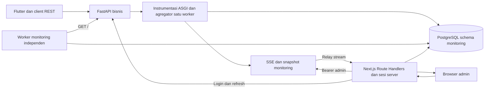
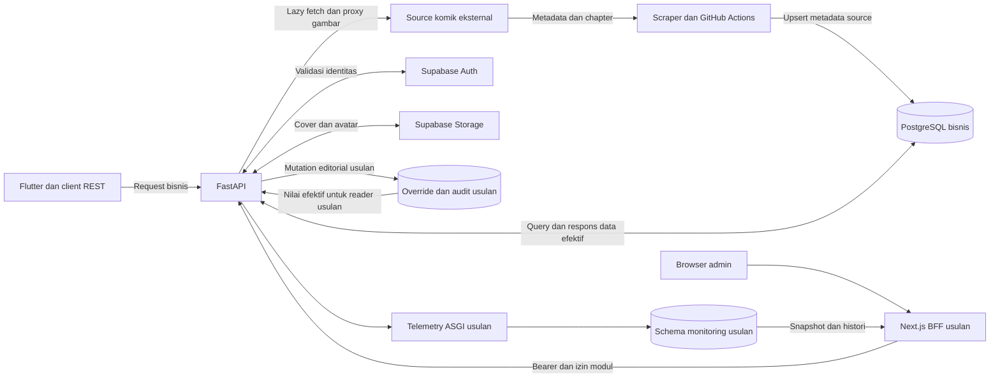
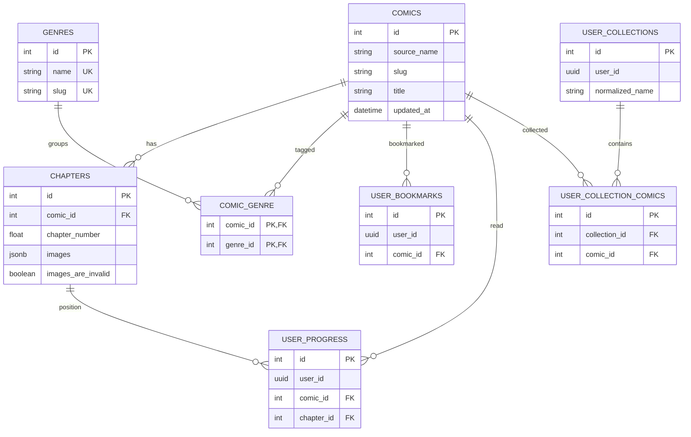
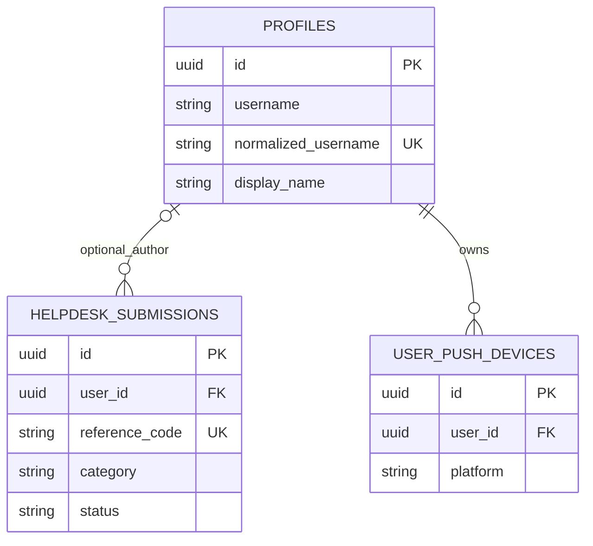
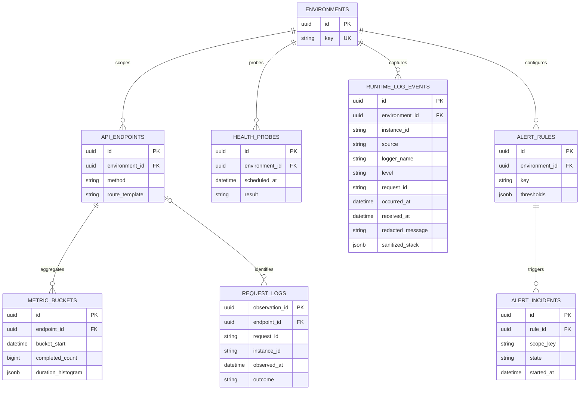
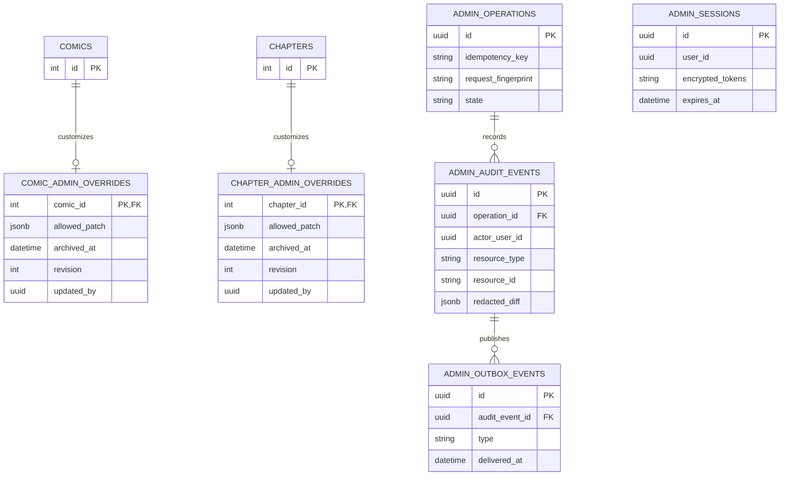
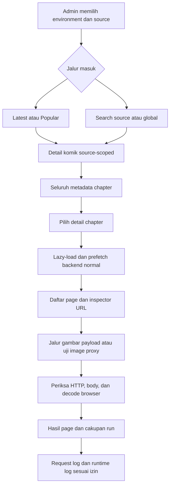

# PRD Web Admin Operasional dan Monitoring REST API TonzToon

| Atribut | Nilai |
| --- | --- |
| Produk | TonzToon Admin |
| Versi dokumen | 1.5 |
| Tanggal | 26 Oktober 2026 |
| Status | Starter Next.js di root web/ tersedia; migrasi halaman dan integrasi produksi masih bertahap |
| Platform | Web admin internal yang responsif pada desktop, tablet, dan mobile |
| Stack utama | Next.js App Router, React, TypeScript, Tailwind CSS, daisyUI, stylesheet CSS modern; backend FastAPI yang sudah ada |
| Bahasa antarmuka | Bahasa Indonesia |

## 1. Ringkasan produk

Catatan pelaksanaan 26 Oktober 2026: fase starter selesai di root `web/`; versi dependency dan bukti instalasi/build/browser starter berada pada [laporan fase 1](admin_starter_phase1.md). Temuan backend pada bagian 2 serta pernyataan belum diimplementasikan pada riwayat revisi menjelaskan baseline penyusunan spesifikasi. Status source saat ini diperiksa tersendiri pada [todo implementasi](todo_web_admin_monitoring.md); keberadaan source tidak membuktikan penerimaan integrasi. Fase frontend berikutnya menunggu konfirmasi pengguna.

Tujuan utama web ini adalah menjadi halaman pengelolaan backend untuk proyek TonzToon pada repository ini. Admin dan developer menggunakannya untuk memantau log FastAPI/Uvicorn serta request REST API secara realtime, memeriksa kesehatan layanan, mengelola data, memahami alur/relasi data, dan menelusuri tindakan admin. Semua fungsi terhubung ke backend FastAPI yang sudah ada melalui integrasi dan instrumentasi yang dibangun untuk proyek ini.

Alur operasional utamanya: temukan insiden pada dashboard, periksa endpoint/request dan log runtime terkait, buka data yang terdampak jika diizinkan, lalu lakukan koreksi tervalidasi dengan preview, kontrol konflik, dan audit. UI/UX tetap mengikuti kebutuhan modern, interaktif, intuitif, dan responsif yang telah ditetapkan.

Aplikasi Next.js ditempatkan langsung pada root `web/`, sesuai keputusan pengguna pada fase starter, 26 Oktober 2026. Direktori `web/prototype/` tetap menjadi referensi HTML terpisah. Backend FastAPI tetap menjadi sumber data bisnis dan telemetry. Modul akun dan helpdesk memakai ulang kontrak backend yang sudah ada setelah pengetatan izin. Admin HTML di `admin/` tetap tersedia selama transisi; penghapusannya memerlukan pekerjaan migrasi tersendiri.

Deliverable PRD ini adalah spesifikasi produk dan implementasi. Perintah instalasi resmi pada bagian 12 dijalankan ketika pembangunan aplikasi dimulai.

Revisi 1.4 menetapkan stack styling aplikasi nyata pada bagian 21: scaffold Next.js resmi, Tailwind CSS, komponen daisyUI semantik, dan stylesheet custom dengan CSS modern yang relevan pada 2026. Visualisasi Data Flow memakai node/card HTML dan dashed arrow SVG custom yang interaktif/beranimasi; ERD memakai React Flow. Preview Komik tetap pada bagian 20 dengan API nyata termasuk lazy-load/prefetch. Rincian visual mengikuti [DESIGN.md](../DESIGN.md); hasil pemeriksaan dokumen berada di [review desain](admin_design_review.md).

Revisi 1.5 menambahkan mode Terminal pada Log Runtime, bagian 19. Output FastAPI/Uvicorn yang ditangkap collector tampil sebagai aliran teks realtime seperti console proses Uvicorn, dengan sanitasi, batas buffer, dan status koneksi yang sama dengan mode Terstruktur. Mode ini merupakan penampil log baca saja; menjalankan command, shell interaktif, atau restart proses tetap di luar cakupan.

### Cakupan yang dikonfirmasi

| Kebutuhan | Cakupan produk |
| --- | --- |
| Pengelolaan backend repository ini | Web admin internal di `web/`, menggunakan layanan FastAPI, database, serta identitas admin proyek ini |
| Log FastAPI/Uvicorn realtime | Mode Terminal dan Terstruktur untuk pesan server, lifecycle, log aplikasi, exception, dan access log tersanitasi pada halaman Log Runtime |
| Monitoring REST API | Dashboard kesehatan, trafik, latensi, request log, endpoint, dan alert |
| Preview Komik | Menguji alur baca nyata dari feed/search sampai decode gambar chapter; hasil per tahap dapat dikorelasikan dengan request/runtime log |
| Manajemen data | Data katalog, chapter, genre, source, akun, dan helpdesk sesuai batas serta izin masing-masing modul |
| Validasi dan pemulihan | Validasi server, preview perubahan, konflik versi, arsip/pulihkan, serta perlindungan relasi data |
| Izin dan audit | RBAC per modul, audit perubahan, dan korelasi tindakan dengan request/operation ID |
| Visualisasi | Flow data interaktif serta empat ERD dengan pembedaan existing, relasi logis, dan usulan migration |
| Styling aplikasi nyata | Tailwind CSS utility-first pada komponen React reusable sebagai pilihan utama; daisyUI untuk komponen semantik; token terpusat dan stylesheet CSS modern hanya untuk pengecualian native/vendor yang beralasan sesuai DESIGN.md |
| Integrasi backend | Instrumentasi ASGI, logging terstruktur, collector, API monitoring/admin-data, penyimpanan, dan stream realtime |

Request log, log runtime, dan audit adalah tiga jenis data berbeda. Request log menjelaskan hasil/durasi request, log runtime menjelaskan kejadian proses/aplikasi, dan audit menjelaskan siapa melakukan perubahan apa. Ketiganya dapat dikorelasikan bila mempunyai ID yang sama, tetapi tidak saling menggantikan atau dihitung sebagai request tambahan.

## 2. Kondisi backend yang sudah diverifikasi

Temuan berikut berasal dari inspeksi source code lokal, bukan pengujian deployment aktif.

| Area | Kondisi saat penyusunan PRD | Implikasi |
| --- | --- | --- |
| Framework | FastAPI; metadata aplikasi mencantumkan versi API `1.25.0` | Versi API berbeda dari versi framework; tampilkan versi runtime yang dilaporkan backend |
| Routing | REST API memakai prefix `/api/v1`; Swagger `/docs`, ReDoc `/redoc`, OpenAPI default `/openapi.json` | Inventaris endpoint dapat berasal dari OpenAPI |
| Kelompok API | Comics, Sources, Search, Genres, Images, Library, Auth, Helpdesk, Notifications, Account Manager, Scraper | Filter dan pengelompokan mengikuti router aktual |
| Health | `GET /` mengembalikan nama aplikasi, versi, status `running`, dan environment | Baru membuktikan respons proses; belum membuktikan database atau dependensi sehat |
| Autentikasi | Bearer token Supabase; login, refresh, logout, dan `/auth/me` tersedia | Gunakan alur autentikasi backend yang ada |
| Otorisasi | `ADMIN_USER_IDS` dan pemeriksaan metadata role sudah digunakan pada helper admin | Monitoring memerlukan gate admin dengan sumber role yang tepercaya, lihat bagian 10 |
| Admin lama | Berkas HTML/JS untuk akun dan helpdesk disajikan melalui `/admin` | Next.js memerlukan runtime Node.js sendiri; bukan berkas statis yang disalin ke mount tersebut |
| Proxy gambar | Endpoint Images menggunakan `StreamingResponse` | Durasi hingga header dan hingga stream selesai harus dibedakan |
| Preview API katalog | Latest/Popular memakai pagination dan respons array; search memakai envelope pagination; daftar chapter source-scoped mengembalikan seluruh item | Preview mematuhi kontrak tiap endpoint, tidak mengasumsikan semua respons mempunyai `total_pages` |
| Preview reader | Detail chapter menjadwalkan nearby prefetch; URL gambar di respons dibungkus oleh `wrap_chapter_image_urls` dengan pengecualian tertentu seperti public Supabase Storage | Pemanggilan preview dapat menulis cache/gambar; gunakan URL proxy yang sudah ada tanpa pembungkusan berulang |
| Scraper | `POST /api/v1/scraper/sync` mengirim workflow dispatch GitHub Actions | Respons berhasil hanya berarti trigger diterima, bukan job scraper selesai |
| Observabilitas | Belum ditemukan router monitoring, metrik request, atau stream telemetry pada `backend/app` | Pengembangan UI harus disertai instrumentasi dan kontrak API baru |
| Logging aplikasi | Beberapa modul `backend/app` sudah memakai Python logging, termasuk logger chapter, image, source, dan account manager | Integrasikan logger existing; pesan bebas/exception memerlukan normalisasi serta redaksi sebelum dikirim ke web |
| Logging server | Dockerfile menjalankan Uvicorn tanpa `--log-config` khusus pada command yang diperiksa | Output server belum otomatis menjadi feed web; konfigurasi logger dan transport collector masih harus dibangun |
| Deployment | Dockerfile menjalankan satu proses Uvicorn; mendukung deployment Hugging Face Spaces | MVP mendukung satu worker API; multiworker memerlukan agregator bersama |

Referensi lokal: [aplikasi FastAPI](../backend/app/main.py), [router](../backend/app/api/router.py), [dependency autentikasi](../backend/app/api/deps.py), [admin akun](../backend/app/api/v1/account_manager.py), [scraper](../backend/app/api/v1/scraper.py), [proxy gambar](../backend/app/api/v1/images.py), [Dockerfile](../Dockerfile).

## 3. Masalah, pengguna, dan tujuan

### Masalah

1. Status proses `running` belum menjelaskan apakah request pengguna berhasil atau semakin lambat.
2. Admin belum mempunyai satu tempat untuk membandingkan volume, error, dan latensi antarendpoint.
3. Masalah katalog, reader, sinkronisasi library, dan proxy gambar membutuhkan korelasi request yang konsisten.
4. Halaman monitoring dapat menyesatkan jika data lama tetap ditampilkan sebagai kondisi sehat.

### Pengguna

| Persona | Kebutuhan utama |
| --- | --- |
| Admin operasional | Mengetahui layanan terganggu, tingkat dampaknya, dan kapan pulih |
| Developer backend | Menelusuri endpoint lambat atau error dengan request ID dan waktu kejadian |
| Pemilik layanan | Melihat tren kesehatan dan availability pada periode yang tersedia |

MVP memisahkan `monitoring:read`, `logs:read`, `preview:read`, `preview:inspect-urls`, `data:read`, `catalog:write`, `helpdesk:manage`, `users:manage`, dan `audit:read`. Membaca monitoring tidak otomatis memberikan akses log runtime, URL sensitif, data pribadi, atau mutation. Pembagian akses dijelaskan pada bagian 15, 19, dan 20; pengubahan rule alert melalui UI tetap P1.

### Hasil yang ditargetkan

Angka berikut merupakan target penerimaan yang perlu dibuktikan saat implementasi, bukan hasil benchmark saat ini.

| Indikator | Target MVP |
| --- | --- |
| Kesegaran telemetry | p95 jarak request selesai sampai terlihat di UI maksimal 3 detik pada koneksi SSE sehat |
| Kesegaran log runtime | p95 jarak event diterima collector sampai tampil di UI maksimal 3 detik saat pipeline sehat; waktu kejadian dan ingest ditampilkan terpisah |
| Waktu investigasi | Admin dapat mencapai detail endpoint dan request terkait dalam maksimal 3 interaksi dari overview |
| Integritas penghitungan | Tidak ada hitungan ganda pada dataset uji; kehilangan telemetry dilaporkan eksplisit |
| Latensi monitoring API | p95 snapshot dan query agregat maksimal 500 ms pada profil beban bagian 11 |
| Dampak instrumentasi | Kenaikan p95 latensi REST maksimal 5% pada perbandingan beban yang sama |
| Otorisasi | Seluruh endpoint dan stream monitoring menolak akses anonim dan nonadmin |

## 4. Ruang lingkup dan prioritas

| Prioritas | Fitur | Hasil |
| --- | --- | --- |
| P0 | Login admin dan sesi aman | Akses terbatas tanpa token pada JavaScript browser |
| P0 | Overview realtime | Kesehatan, RPS, error rate, latensi, in-flight, dan waktu data terakhir |
| P0 | Inventaris dan detail endpoint | Route template, method, statistik, grafik, dan request terkait |
| P0 | Live request log | Feed tersanitasi, filter, pause/resume, serta detail request |
| P0 | Log runtime FastAPI/Uvicorn | Mode Terminal realtime dan Terstruktur, feed server/aplikasi/access log, lifecycle, severity, exception tersanitasi, dan korelasi request |
| P0 | Preview Komik dan uji alur baca | Feed Latest/Popular, search, detail, chapter lengkap, URL gambar, mini reader, dan diagnosis image proxy memakai API nyata |
| P0 | Health dan availability | Liveness independen, status dependensi terukur, riwayat probe |
| P0 | Alert internal | Rule bawaan, insiden aktif, riwayat pemulihan; evaluasi tanpa browser terbuka |
| P0 | Ketahanan koneksi | SSE, reconnect, polling cadangan, status stale, dan rekonsiliasi snapshot |
| P0 | Instrumentasi dan penyimpanan | Metrik seluruh request saat pipeline sehat, log tersampel, retensi terbatas |
| P0 | Manajemen katalog | Daftar/detail, tambah data tervalidasi, edit metadata, arsip/pulihkan, dan audit |
| P0 | Manajemen akun dan helpdesk | Integrasi kontrak yang ada dengan izin per modul; library pengguna bersifat baca terbatas |
| P0 | Data flow dan ERD explorer | Diagram arsitektur, metrik edge yang terukur, pencarian entitas, dan relasi schema |
| P0 | Desain modern dan responsif | Sistem desain TonzToon, akses keyboard, form jelas, dan layout yang menyesuaikan konten |
| P1 | Rule alert yang dapat diubah | Threshold, periode, acknowledge, dan mute dengan audit |
| P1 | Notifikasi eksternal | Email atau kanal lain setelah integrasi dan tujuan pengiriman ditentukan |
| P1 | Multiworker/multiinstance | Agregator dan event bus bersama sebelum penambahan worker |
| P1 | Observasi job scraper | Integrasi status run GitHub Actions; tidak menyimpulkan hasil dari dispatch |
| P1 | Ekspor dan diagnosis lebih dalam | Ekspor log tersanitasi, tracing, CPU/memori, query DB, metrik upstream per source |
| P1 | Operasi data lanjutan | Import/bulk edit, hard delete dengan impact preview, serta perbaikan gambar melalui job terkontrol |

Di luar MVP: hard delete katalog/akun, perubahan role istimewa melalui UI, replay mutation/request bisnis arbitrer, pemicu scraper dari dashboard, restart layanan, manajemen secrets, dan penghapusan admin HTML lama. GET terkontrol pada Preview Komik beserta lazy-load/prefetch normal termasuk P0. Monitoring HTTP backend tidak otomatis memberikan metrik internal GitHub Actions, database, atau layanan upstream; masing-masing membutuhkan instrumentasi tambahan. Arsip data yang dapat dipulihkan termasuk P0 dan berbeda dari hard delete.

## 5. Navigasi, pengalaman pengguna, dan visual

### Struktur halaman

| Halaman | Rute Next.js | Isi utama |
| --- | --- | --- |
| Login | `/login` | Identifier/email, password, validasi, status sesi |
| Overview | `/overview` | KPI, grafik trafik/error/latensi, health, endpoint bermasalah, alert aktif |
| Endpoint | `/endpoints` | Tabel inventaris dengan filter dan sort |
| Detail endpoint | `/endpoints/[endpointId]` | Grafik, distribusi status, histogram latensi, log terkait |
| Request log | `/requests` | Feed live dan pencarian log tersimpan |
| Log runtime | `/runtime-logs` | Mode Terminal/Terstruktur, filter sumber/level, pause/autoscroll, exception tersanitasi, dan status collector |
| Preview Komik | `/comic-preview` | Pilih source, Latest/Popular, search per source/global, dan mulai sesi diagnosis |
| Preview detail komik | `/comic-preview/[source]/[slug]` | Metadata API dan daftar chapter lengkap dengan navigasi |
| Preview reader | `/comic-preview/[source]/[slug]/chapters/[chapter]` | Page chapter, URL inspector, status proxy/decode, dan timeline diagnosis |
| Health | `/health` | Liveness, dependency checks, availability, histori probe |
| Alert | `/alerts` | Insiden aktif dan riwayat transisi |
| Katalog | `/data/comics` | Tabel komik, filter source, detail, tambah/edit, arsip/pulihkan |
| Chapter | `/data/comics/[comicId]/chapters` | Metadata chapter dan pemeriksaan daftar gambar secara baca |
| Genre | `/data/genres` | Daftar, tambah/edit nama genre, dan relasi komik |
| Source | `/data/sources` | Registry dan statistik source secara baca |
| Akun | `/data/accounts` | Data akun, status, profil, dan ringkasan relasi sesuai izin |
| Helpdesk | `/data/helpdesk` | Antrian laporan/review, status proses, dan catatan internal |
| Detail library | `/data/accounts/[userId]/library` | Ringkasan relasi baca terbatas; akses konten memerlukan izin khusus |
| Audit | `/data/audit` | Jejak tindakan admin dan metadata perubahan tersanitasi |
| Data flow | `/data-flow` | Canvas arsitektur, status terukur, filter, serta panel detail |
| ERD explorer | `/data-model` | Diagram relasi, data dictionary, dan pencarian tabel/kolom |

Navigasi dikelompokkan menjadi Monitoring, Preview Komik, Data, dan Alur & Model; hanya modul yang diizinkan terlihat, sementara backend tetap memeriksa akses URL langsung. Header monitoring memuat environment, rentang waktu, mode Live/Historis, status koneksi, dan waktu data terakhir. Halaman Data memakai toolbar pencarian/filter dan aksi kontekstual. Environment berasal dari allowlist server. Breadcrumb dan tautan detail mempertahankan filter, pagination, dan environment saat kembali.

### Arah visual

- Dashboard operasional dengan kepadatan informasi sedang, latar netral, dan aksen merek TonzToon. Tema mengikuti pilihan tersimpan lalu preferensi sistem; dark menjadi fallback konteks monitoring. Light/dark tersedia sejak MVP.
- Hijau untuk sehat, amber untuk terdegradasi, merah untuk gagal, abu-abu untuk belum diketahui. Setiap warna disertai teks atau ikon.
- Angka menggunakan format `id-ID`, satuan eksplisit `ms`, `req/s`, `%`, dan `byte`; route dan request ID memakai font monospace.
- Grafik menyediakan tooltip, legenda, serta ringkasan angka yang dapat diakses keyboard. Navigasi, dialog, dan tabel menargetkan WCAG 2.2 AA.
- Layout mengikuti kebutuhan konten: desktop memakai daftar/canvas dengan inspector, tablet memakai panel detail yang dapat dibuka, dan mobile memakai daftar prioritas serta detail satu kolom. Tabel lebar hanya boleh bergeser dalam region berlabel; halaman tidak meluber horizontal. Ketentuan rinci ada pada sistem desain.

### Alur inti

1. Admin login, lolos otorisasi backend, kemudian melihat snapshot terbaru dan koneksi live.
2. Admin memilih endpoint dengan p95 tinggi, membuka detail, lalu memfilter request lambat pada periode yang sama.
3. Saat backend tidak dapat dijangkau, UI menampilkan kegagalan probe dan waktu data terakhir; angka historis tetap diberi label historis.
4. Saat feed dipause, daftar request berhenti bergerak dan penghitung event baru bertambah; kartu kesehatan dan alert tetap diperbarui. Resume mengambil snapshot baru jika buffer terlampaui.
5. Saat memilih rentang historis, grafik tidak bergeser mengikuti waktu sekarang; kembali ke Live mengambil ulang snapshot.
6. Admin berizin membuka Log Runtime dalam mode Terminal untuk mengikuti output FastAPI/Uvicorn, menghentikan autoscroll ketika membaca traceback, lalu memilih WARNING/ERROR atau logger tertentu. Admin dapat berpindah ke mode Terstruktur dan membuka request terkait jika ID korelasi tersedia. Log startup/background tanpa request ID tetap dapat ditelusuri berdasarkan waktu, environment, dan instance.
7. Admin menjalankan Preview Komik: pilih source → Latest/Popular atau search → detail → daftar chapter lengkap → chapter → page melalui proxy. Timeline memperlihatkan tahap yang gagal serta request terkait, tanpa mengubah progress/bookmark pengguna.

## 6. Kebutuhan fungsional dan kriteria penerimaan

### FR-01: Autentikasi dan sesi

- Login memakai `POST /api/v1/auth/login`, dengan identifier/email dan password sesuai schema backend; refresh dan logout memakai endpoint yang tersedia.
- Setelah login, periksa izin melalui endpoint monitoring; respons login saja tidak membuktikan status admin.
- Sesi browser menggunakan cookie ID sesi opaque `HttpOnly`, `Secure` pada produksi, `SameSite=Lax`; token disimpan dan dienkripsi pada session store server, bukan localStorage atau URL.
- Session store memiliki TTL, invalidasi logout, dan pengendalian refresh paralel agar rotasi refresh token tidak saling menimpa.
- **AC:** anonim menerima 401; user sah tanpa izin menerima 403; token kedaluwarsa memicu refresh terkontrol atau kembali ke login tanpa loop.

### FR-02: Overview realtime

- KPI: jumlah request selesai, RPS, HTTP 5xx error rate, HTTP 4xx rate, p50/p95/p99, in-flight, dan availability liveness.
- Grafik trafik, distribusi status, dan latensi; tabel endpoint dengan volume terbesar, p95 tertinggi, serta jumlah 5xx tertinggi.
- Rentang bawaan 15 menit; pilihan 5 menit, 1 jam, dan 24 jam. Rentang kustom maksimal 7 hari sesuai retensi.
- Tampilkan `observed_at`, umur data, `coverage`, sampling log, dan status pipeline. Data yang tidak tersedia menampilkan `Belum tersedia`, bukan nol.
- **AC:** setelah traffic uji selesai, KPI berubah dalam target kesegaran; seluruh kartu menggunakan filter dan cutoff waktu yang konsisten.

### FR-03: Inventaris dan detail endpoint

- Gabungkan inventaris OpenAPI dengan telemetry; endpoint yang belum menerima traffic tetap terlihat dengan status `Belum ada trafik`.
- Identitas endpoint adalah method + route template, misalnya `GET /api/v1/sources/{source}/comics/{slug}`. URL konkret tidak menjadi label agregasi.
- Filter: kelompok router, method, kelas status, environment, dan pencarian route. Sort: request count, error rate, p95, serta last seen.
- Detail menampilkan grafik sesuai rentang terpilih, jumlah sampel, request lambat, dan tautan dokumentasi endpoint.
- Jika OpenAPI gagal dimuat, pertahankan inventaris terakhir dengan waktu snapshot serta banner kegagalan pemuatan.
- **AC:** request untuk dua slug pada template yang sama masuk satu endpoint; method berbeda tetap dipisahkan.

### FR-04: Live request log dan detail

- Kolom: waktu, request ID, method, route template, status HTTP jika tersedia, outcome, durasi, environment, instance ID.
- Filter: request ID persis, endpoint, method, status, outcome, durasi minimum, dan waktu. Riwayat memakai pagination cursor stabil.
- Detail hanya memuat metadata yang disetujui dan kode error tersanitasi. Body, token, cookie, email, query mentah, dan URL gambar bertoken tidak dikumpulkan.
- Buffer browser maksimal 1.000 row; default page riwayat 50, maksimal 100. Update dibatch maksimal sekali per detik tanpa memaksa scroll.
- Log sukses disampel; log error dan request lambat diprioritaskan dalam batas penyimpanan. Pencarian ID yang tidak disimpan menjelaskan kemungkinan sampling, retensi, atau kehilangan data.
- **AC:** pause tidak mengubah posisi scroll; resume tidak menggandakan row; request sensitif tidak membocorkan credential melalui feed maupun detail.

### FR-05: Health dan availability

- Pisahkan status **layanan**, **pipeline telemetry**, dan **koneksi browser**. Putusnya SSE tidak otomatis berarti backend down.
- Probe liveness independen memanggil `GET /` setiap 5 detik dengan timeout 2 detik. Dua probe gagal berturut-turut menandai layanan tidak terjangkau; dua sukses memulihkannya.
- Worker probe berjalan di luar proses/container API yang dipantau dan tetap aktif tanpa viewer. Jika hanya ada satu host, jelaskan bahwa kegagalan host bersama tetap menjadi blind spot.
- Backend menyediakan pemeriksaan dependency database ringan dengan timeout dan cache 10 detik. Supabase Auth/Storage dan upstream source menampilkan `Belum dipantau` sampai ada probe khusus; konfigurasi tersedia tidak sama dengan layanan sehat.
- Availability dihitung dari probe terjadwal yang benar-benar tercatat, disertai coverage jadwal. Slot tanpa hasil adalah `unknown` dan tidak dihitung sebagai sukses.
- **AC:** API berhenti tetapi worker probe tetap hidup: status gagal muncul paling lambat 15 detik; probe worker berhenti: coverage turun dan status berubah menjadi unknown setelah data kedaluwarsa.

### FR-06: Alert internal

- Evaluator berjalan pada worker monitoring setiap 5 detik dengan data bersama; evaluasi tidak bergantung pada tab browser.
- Rule bawaan: liveness dua kali gagal; 5xx rate > 5% pada jendela 5 menit dengan minimal 100 request selesai; p95 > 2.000 ms pada jendela 5 menit dengan minimal 100 pengukuran durasi.
- Rule metrik aktif setelah kondisi terpenuhi terus selama 60 detik. Setelah kondisi sehat selama 60 detik, tandai pulih. Liveness memakai aturan probe FR-05.
- State insiden: `pending`, `firing`, `resolved`; identitas rule + environment + scope mencegah insiden duplikat. Simpan waktu mulai, nilai pemicu, threshold, dan waktu pulih.
- Data stale atau coverage tidak memadai membuat evaluasi `unknown`, tidak menyatakan insiden pulih. Tampilkan alert pipeline terpisah bila tidak ada pembaruan selama 30 detik.
- **AC:** 6 error dari 100 request memenuhi threshold 5xx, sedangkan 1 dari 2 belum cukup sampel; satu kejadian menghasilkan satu insiden aktif dan satu transisi pemulihan.

### FR-07: Status kosong, error, dan pemulihan

- Bedakan loading pertama, tidak ada trafik, tidak cocok filter, riwayat belum tersedia, akses ditolak, timeout, data parsial, backend down, dan telemetry terputus.
- Snapshot terakhir boleh tetap terlihat dengan label waktu dan status stale. Jangan mempertahankan badge sehat ketika status sudah tidak diketahui.
- Retry manual tersedia; retry otomatis memakai backoff dan jitter. HTTP 401/403 menghentikan retry data sampai sesi/izin diperbaiki.
- **AC:** kehilangan jaringan, reconnect, refresh halaman, dan perubahan filter tidak menggandakan subscription atau menghapus konteks investigasi.

## 7. Definisi metrik dan ketepatan data

| Metrik | Definisi |
| --- | --- |
| Request count | Jumlah request bisnis yang menyelesaikan respons pada jendela waktu; dihitung sebelum sampling log |
| RPS | Request selesai dibagi durasi detik yang benar-benar tercakup pada jendela; UI menampilkan coverage bila parsial |
| 5xx rate | Respons HTTP 500 sampai 599 dibagi seluruh respons HTTP selesai, dikali 100% |
| 4xx rate | Respons HTTP 400 sampai 499 dibagi seluruh respons HTTP selesai; tidak digabung sebagai server error |
| Latensi | Waktu monotonic dari request diterima sampai body respons selesai dikirim oleh aplikasi ASGI; bukan latensi jaringan end-to-end pengguna |
| Time to headers | Durasi sampai `http.response.start`; ditampilkan terpisah, terutama untuk proxy gambar |
| p50/p95/p99 | Estimasi dari histogram durasi seluruh respons HTTP selesai; tampilkan jumlah observasi dan label estimasi |
| In-flight | Request bisnis yang sedang berlangsung pada proses API yang dipantau |
| Availability | Probe liveness sukses / probe dengan hasil sukses atau gagal; tampil bersama jumlah probe dan coverage terhadap jadwal |
| Freshness | Selisih waktu sekarang dengan `observed_at` telemetry/probe; berbeda dari heartbeat koneksi SSE |

Ketentuan instrumentasi:

1. Gunakan middleware ASGI yang mengamati status dan body final. Contoh `call_next` yang berhenti saat header tersedia tidak cukup untuk durasi penuh `StreamingResponse`.
2. Catat request tepat sekali, termasuk respons 422, HTTP exception, dan unhandled 500. Request yang terputus sebelum selesai diberi outcome `client_disconnected`/`aborted`; jangan membuat status HTTP 499 seolah dikirim backend.
3. In-flight berkurang pada blok finalisasi, termasuk exception dan cancellation. Request ID dibuat/diterima setelah validasi format dan batas 128 karakter; header respons mengekspos ID yang dipakai. Setiap observasi juga mempunyai observation ID internal unik; request ID tidak dijadikan primary key atau kunci deduplikasi.
4. Kecualikan `/api/v1/monitoring/*`, `/`, `/docs`, `/redoc`, `/openapi.json`, `/admin/*`, serta preflight OPTIONS dari metrik bisnis. Request admin-data/account-manager dan operasi administratif helpdesk diberi `traffic_scope=administration`; request Preview Komik diberi `traffic_scope=admin_preview` setelah identitas BFF/izin divalidasi. Kedua scope dapat diperiksa tersendiri dan tidak masuk KPI trafik pembaca secara default. Header dari client publik tidak boleh cukup untuk menyembunyikan request dari metrik bisnis.
5. Rute tidak dikenal memakai label terbatas `__unmatched__`; jangan menyimpan path mentah. Label source hanya dari registry backend yang valid. Field dengan kardinalitas tinggi tidak dijadikan dimensi histogram.
6. Bucket histogram durasi dalam ms: 5, 10, 25, 50, 100, 250, 500, 1.000, 2.500, 5.000, 10.000, 30.000, 60.000, dan +Inf. Nilai quantile di bucket terbuka ditampilkan sebagai batas bawah, misalnya `≥60.000 ms`.
7. Untuk agregasi rentang, jumlahkan count dan bucket histogram sebelum menghitung quantile; jangan merata-ratakan p95 tiap menit. Pembagi nol menghasilkan `Belum ada data`.
8. Seluruh timestamp dikirim sebagai UTC ISO 8601; UI memakai zona waktu browser dan menampilkan label zona. Rentang mengikuti interval `[from, to)`.
9. Snapshot memuat watermark/cutoff yang sama untuk semua metrik. Interval yang kehilangan data ditandai parsial, bukan diisi angka nol.

## 8. Arsitektur dan kontrak integrasi

### Aliran data



Next.js bertindak sebagai Backend for Frontend (BFF). Browser memakai origin yang sama; BFF meneruskan kredensial ke FastAPI di sisi server. Akses database BFF dibatasi untuk session store serta pembacaan hasil probe/insiden agar status tetap dapat ditampilkan saat FastAPI mati. Query agregat dan log request tetap melalui API monitoring. Kredensial database operasional Flutter tidak pernah masuk ke browser.

Untuk log runtime, collector berjalan terpisah dari proses Uvicorn dan menyimpan event tersanitasi. BFF memiliki izin baca terbatas pada log store serta pemeriksaan `logs:read` sehingga histori dan event collector yang masih tersedia dapat ditampilkan saat proses API gagal. BFF dan backend memakai sumber izin tepercaya yang konsisten dan dapat diperiksa tanpa memanggil API bisnis; bila sesi/izin tidak dapat divalidasi, akses log ditolak. Ini tidak memberi BFF akses tulis ke data bisnis.

### Endpoint baru yang harus dibangun

Seluruh endpoint berikut merupakan usulan, belum tersedia. Prefix FastAPI: `/api/v1/monitoring`. Semua membutuhkan bearer admin yang valid. BFF menyediakannya sebagai `/api/monitoring/*` pada origin web admin.

| Method | Path relatif | Kontrak utama |
| --- | --- | --- |
| GET | `/capabilities` | Izin monitoring, schema version, retensi, sampling, mode worker, fitur tersedia |
| GET | `/snapshot` | KPI dan status dengan `window`, `observed_at`, `snapshot_id`, `coverage`, `instance_id` |
| GET | `/timeseries` | `from`, `to`, `interval`; bucket count, error, duration histogram, coverage |
| GET | `/endpoints` | Inventaris + agregat; filter method/group dan cursor |
| GET | `/endpoints/{endpoint_id}` | Detail route, statistik, serta metadata dokumentasi |
| GET | `/requests` | Filter terverifikasi dan pagination `{items, next_cursor, retention, sampling}` |
| GET | `/requests/{observation_id}` | Detail observasi tersanitasi; pencarian request ID dilakukan melalui filter `/requests` dan dapat menghasilkan beberapa observasi |
| GET | `/runtime-logs` | Event runtime tersanitasi, filter logger/level/jenis/instance/waktu/request ID, dan cursor stabil; membutuhkan `logs:read` |
| GET | `/runtime-logs/{log_event_id}` | Detail event, stack terstruktur yang disetujui, dan metadata korelasi; tanpa locals atau credential |
| GET | `/health` | Status dependency backend yang tercache; hasil probe independen dilengkapi oleh BFF |
| GET | `/alerts` | Insiden tersimpan; BFF memakai jalur baca terbatas ketika API tidak tersedia |
| GET | `/stream` | SSE event versioned; snapshot, request batch, heartbeat, dan reset |

BFF menyediakan tambahan `GET /api/monitoring/runtime-logs/stream` dengan sesi cookie dan izin `logs:read`. Stream ini mengambil data dari jalur collector/log store, bukan bergantung pada stream FastAPI yang sedang dipantau. Endpoint list/detail BFF juga dapat memakai jalur baca log store tersebut saat API mati. Stream runtime mempunyai cursor/replay sendiri dan ikut batas total koneksi SSE pada bagian 10; viewer umum tidak disubscribe otomatis.

Query API monitoring memakai `cache: 'no-store'`; respons berisi `Cache-Control: private, no-store`. Filter divalidasi dan dinormalisasi server; batas rentang 7 hari, page maksimal 100, dan satu detail request tidak mengembalikan body bisnis. Window realtime 5/15 menit memakai data satu detik dari memori; riwayat memakai bucket satu menit yang sudah selesai. Interval historis mengikuti batas menit dan server mengembalikan rentang efektif agar UI tidak memberi kesan presisi yang tidak tersedia.

Envelope snapshot contoh:

```json
{
  "schema_version": 1,
  "snapshot_id": "instance-a:2042",
  "instance_id": "instance-a",
  "environment": "production",
  "observed_at": "2026-10-24T05:00:00Z",
  "window": {"from": "2026-10-24T04:45:00Z", "to": "2026-10-24T05:00:00Z"},
  "coverage": {"state": "complete", "duration_seconds": 900, "telemetry_dropped": 0},
  "metrics": {"completed": 1200, "server_errors": 12, "rps": 1.33, "error_rate_percent": 1.0, "p95_ms": 240, "in_flight": 3}
}
```

Angka pada contoh hanya ilustrasi kontrak. Pada snapshot parsial, `coverage.state` menjadi `partial`; metrik yang tidak dapat dihitung secara sah bernilai `null`.

## 9. Realtime, penyimpanan, dan deployment

### Protokol realtime

- Pilihan MVP adalah SSE karena aliran utama satu arah dari backend ke dashboard. Polling adalah fallback; Supabase Realtime tidak menjadi prasyarat.
- Snapshot/agregat dikirim setiap 1 detik; request dibatch per detik; heartbeat setiap 15 detik. Event memuat `schema_version`, `id`, `type`, `environment`, `emitted_at`, dan payload.
- Jenis event dasar: `snapshot`, `request_batch`, `heartbeat`, `reset`; revisi 1.1 menambah `resource_changed` dan `topology_status` dengan filter izin. Snapshot menggantikan state agregat, bukan ditambahkan ke total lama. Deduplikasi request memakai observation ID dan event memakai instance + sequence atau ID outbox yang stabil.
- BFF mengautentikasi sesi cookie, lalu membuka stream FastAPI dengan header Authorization; native EventSource browser tidak perlu mengirim bearer header.
- Backend menutup stream ketika token upstream kedaluwarsa atau izin dicabut; periksa ulang izin paling lambat setiap 30 detik. Browser melakukan refresh sesi melalui BFF sebelum menyambung kembali.
- Simpan replay buffer event maksimal 5 menit dan maksimal 100.000 event. Reconnect meneruskan `Last-Event-ID`; cursor di luar buffer atau instance berbeda menghasilkan `reset` dan fetch snapshot baru.
- Reconnect memakai backoff 1, 2, 4, 8, 16, maksimal 30 detik dengan jitter. Setelah 3 kegagalan berturut-turut, aktifkan polling snapshot setiap 5 detik; percobaan SSE dapat dilakukan ulang tiap 30 detik.
- Jangan jalankan polling dan stream aktif secara bersamaan. Jika heartbeat tidak diterima 30 detik, status koneksi stale. Freshness telemetry memiliki pemeriksaan terpisah meskipun heartbeat masih masuk.
- BFF meneruskan pembatalan browser ke request upstream. Antrean subscriber dibatasi; viewer lambat menerima `reset`/disconnect dan tidak boleh menahan request bisnis.

### Penyimpanan dan retensi

| Data | Penyimpanan MVP | Retensi/batas |
| --- | --- | --- |
| Agregat realtime | Memori proses API; bucket satu detik | Maksimal 15 menit; reset proses terlihat di coverage |
| Request live | Ring buffer tersanitasi | Maksimal 5 menit dan 10.000 request; terpisah dari replay event |
| Agregat historis | PostgreSQL schema `monitoring`, bucket satu menit + histogram | 7 hari |
| Log request tersimpan | PostgreSQL `monitoring`, sampling sukses awal 1%; error/slow diprioritaskan | 24 jam, maksimal 50.000 row/environment/hari |
| Log runtime live | Buffer collector tersanitasi | Maksimal 5 menit, 1.000 event, atau 8 MiB; batas yang tercapai lebih dahulu berlaku |
| Log runtime tersimpan | PostgreSQL `monitoring.runtime_log_events` | 24 jam, maksimal 25.000 event atau 32 MiB payload tersanitasi/environment/hari; lihat prioritas dan coverage bagian 19 |
| Probe dan insiden | PostgreSQL `monitoring` | Probe 7 hari; insiden 30 hari |
| Sesi admin | Tabel sesi server dengan token terenkripsi | TTL mengikuti sesi; hapus saat logout/kedaluwarsa |

- Agregator menghitung semua request bisnis sebelum sampling selama pipeline sehat. Sampling raw log tidak mengurangi count/histogram.
- Flush agregat ke DB secara asynchronous setiap 5 detik. Gunakan batch ID unik dan ledger idempotensi agar retry tidak menggandakan delta; snapshot UI memakai cutoff terkoordinasi supaya data memori dan DB tidak dijumlahkan dua kali.
- I/O telemetry tidak memblokir jalur bisnis. Buffer terbatas, timeout, dan kebijakan drop eksplisit; expose `telemetry_dropped`, `last_persisted_at`, serta keadaan storage. Batas log yang tercapai menurunkan coverage log, bukan memalsukan metrik trafik.
- Crash dapat menghilangkan data yang belum di-flush. Restart mengubah instance ID, menandai interval parsial, dan mengembalikan histori tersimpan; jangan menjanjikan zero loss.
- Worker menjalankan pembersihan retensi dan evaluasi alert. Tabel telemetry dipisahkan dari data bisnis, diindeks sesuai query waktu/environment/endpoint, dan tidak memakai query scan katalog/chapter sebagai probe.
- Log berprioritas pun dapat terpangkas saat batas tercapai; tampilkan jumlah yang tidak disimpan. Payload telemetry tidak boleh menjadi penyimpanan tak terbatas.

### Deployment

MVP terdiri dari runtime Next.js Node.js, FastAPI satu worker, PostgreSQL yang sudah tersedia dengan schema/tabel monitoring baru, dan satu worker monitoring independen untuk probe/evaluasi/retensi. Worker dapat dibuat sebagai proses Python terpisah menggunakan runtime backend yang ada; jalankan di luar container API. Beri worker identitas writer telemetry dengan izin terbatas, bukan hak admin bisnis.

Tambahkan collector log yang dimulai sebelum Uvicorn dan tidak bergantung pada lifespan FastAPI. Transport dapat memakai supervisor/collector stdout-stderr terstruktur atau adapter log platform yang berizin; pilih sesuai host yang benar-benar dipakai. Collector harus mampu menerima startup failure, shutdown, dan event proses tanpa request HTTP. Jika host tidak menyediakan transport yang diperlukan, status sumber log adalah `Belum tersedia` dan P0 logging belum boleh dinyatakan selesai. Probe independen tetap diperlukan untuk mendeteksi hard crash ketika proses tidak sempat mengeluarkan log.

MVP hanya mendukung satu worker/satu instance API. Startup/deployment harus memvalidasi konfigurasi ini; jika topology tidak dapat diverifikasi, operator wajib menguncinya sebelum go-live. Menambah worker tanpa agregator bersama akan memecah count dan stream. P1 memperkenalkan collector/event bus bersama, misalnya Redis atau collector observabilitas, beserta konsistensi snapshot, deduplikasi, dan agregasi lintas instance.

Reverse proxy harus mendukung `text/event-stream`, mematikan buffering/cache stream, dan menyediakan idle timeout lebih panjang dari heartbeat. Host Next.js harus mendukung koneksi streaming panjang; validasi durasi maksimum platform sebelum memilih deployment. Static export Next.js tidak memenuhi kebutuhan sesi server dan BFF. Pada Hugging Face atau platform yang dapat sleep, tampilkan masa tidak terjangkau berdasarkan probe dan label penyebab hanya jika ada bukti.

## 10. Keamanan dan privasi

1. Validasi JWT issuer, audience, signature, dan expiry menggunakan mekanisme backend. Monitoring menerima admin dari `ADMIN_USER_IDS` atau `app_metadata` yang dikelola server. `user_metadata` yang dapat diubah pengguna tidak boleh menjadi sumber pemberian izin; helper admin lama perlu ditinjau sebelum dipakai ulang.
2. Backend tetap memeriksa izin di setiap endpoint monitoring. BFF tidak menjadi satu-satunya lapisan otorisasi. `ALLOW_DEV_USER_HEADER=false` pada environment bersama/produksi.
3. Semua alamat backend dan environment berasal dari allowlist server; browser tidak dapat menetapkan URL target bebas. Gunakan TLS pada produksi.
4. Redaksi dilakukan sebelum antrean, persistensi, atau broadcast. Jangan merekam Authorization, Cookie, Set-Cookie, password, token Supabase/GitHub/FCM, service-role key, URL query mentah, atau body request/response.
5. Cookie/session secret, database credential, dan backend URL operasional berada pada environment server. Jangan menggunakan prefix `NEXT_PUBLIC_` untuk secrets. Session token terenkripsi dengan key yang dikelola di server dan mempunyai prosedur rotasi.
6. Periksa Origin/CSRF pada login, refresh, logout, dan mutasi mendatang. Batasi laju login, query mahal, dan koneksi SSE; baseline maksimal 2 stream per user/environment, 20 stream total pada profil MVP, serta 60 read request/menit/user dengan burst kecil.
7. Simpan audit login, penolakan akses, logout, dan perubahan konfigurasi operasional dengan metadata minimum; tanpa credential. Tampilan error umum tidak mengekspos stack trace atau konfigurasi backend. Inspector Log Runtime berizin dapat menampilkan tipe exception dan stack terstruktur yang telah disanitasi, tanpa locals, payload bisnis, atau absolute path sensitif.

## 11. Kebutuhan nonfungsional dan validasi

Profil beban awal untuk acceptance: satu worker API, satu environment, 100 request bisnis/detik selama 15 menit, maksimal 200 route template, 20 viewer SSE bersamaan, dan data historis tujuh hari. Campuran uji mencakup respons JSON, 4xx/5xx, serta proxy gambar/stream; rincian hardware dan ukuran payload dicatat bersama hasil.

| Area | Persyaratan dan cara membuktikan |
| --- | --- |
| Performa UI | Overview usable maksimal 3 detik pada staging dengan RTT 100 ms; pembaruan live tidak mereset scroll/fokus |
| Overhead | Bandingkan baseline vs instrumentasi pada workload identik; target kenaikan p95 maksimal 5% |
| Memori | Ring buffer, replay buffer, dan antrean subscriber mempunyai batas; tidak tumbuh terus setelah 15 menit beban stabil |
| Konsistensi | Dataset deterministik membuktikan count/status/histogram, batas waktu, dan pengecualian route |
| Streaming | Uji time-to-headers berbeda dari durasi body; disconnect membatalkan upstream dan menurunkan in-flight |
| Otorisasi | Uji anonim, nonadmin, admin, token expired, perubahan izin, dan role pada user_metadata |
| Privasi | Masukkan secret sintetis pada header/query/body; pastikan tidak muncul di DB, event, detail, atau log aplikasi |
| Ketahanan | Uji API down, DB down, worker probe down, restart API, buffer overflow, replay gap, dan koneksi lambat |
| Histori | Uji retensi, sampling, batas row, flush retry idempotent, dan gap data setelah crash |
| Logging runtime | Uji startup/import failure sebelum lifespan, logger existing, stdout/stderr, traceback multiline, collector restart, redaksi, batas event/byte, dan akses saat API down |
| Alert | Gunakan clock terkontrol untuk threshold, minimum sample, pending, deduplikasi, stale, dan pemulihan |
| Deployment | Uji SSE melalui reverse proxy/host sebenarnya, sesi lintas reload, cleanup koneksi, dan graceful shutdown |
| Aksesibilitas | Keyboard, fokus, status tanpa ketergantungan warna, kontras AA, dan mode reduced motion |

Validasi browser end-to-end minimum: login → overview → detail endpoint → request log; reconnect SSE → fallback polling → kembali live; backend down → insiden → pulih; sesi kedaluwarsa → refresh/logout. Lulus lint/typecheck/build belum membuktikan integrasi backend, performa, atau streaming di host produksi.

## 12. Stack dan instalasi framework resmi

### Keputusan stack

| Lapisan | Pilihan |
| --- | --- |
| Framework | Next.js stable yang dihasilkan installer resmi, App Router |
| Bahasa dan UI | TypeScript, React bawaan Next.js, Tailwind CSS dari scaffold resmi, dan daisyUI sebagai plugin komponen semantik |
| Stylesheet custom | CSS modern yang dikompilasi pada pipeline Tailwind; token, tema, override terbatas, dan komponen domain |
| Visualisasi flow | Komponen React custom: node/card DOM, konektor SVG dashed dengan panah, animasi arah/aktivitas dan interaksi viewer |
| Visualisasi ERD | React Flow `@xyflow/react`, dimuat khusus halaman ERD dengan tema TonzToon |
| Render | Server Components untuk shell dan data awal yang terotorisasi; Client Components untuk grafik, filter, dan subscription |
| BFF | Next.js Route Handlers pada runtime Node.js; kredensial dan session store hanya di server |
| Realtime | SSE melalui Route Handler; polling cadangan |
| Persistensi | PostgreSQL/Supabase yang ada, schema monitoring; sesi server dengan hak akses terpisah |
| Grafik/tabel | daisyUI untuk tabel dan kontrol; library grafik bila diperlukan dipilih berdasarkan aksesibilitas, bundle, dan kebutuhan data |

Dokumentasi Next.js yang diambil melalui Context7 mencantumkan minimum Node.js `>=20.9.0`. Saat bootstrap gunakan Node.js LTS yang masih didukung dan memenuhi `engines` versi stable yang benar-benar terpasang; catat versi Node.js, npm, Next.js, dan React pada README aplikasi. Jangan menyimpulkan versi stable terkini dari daftar versi Context7 atau memasang canary tanpa kebutuhan.

Dari root repository, bootstrap aplikasi pada direktori baru menggunakan CLI resmi:

```powershell
rtk proxy npx create-next-app@latest web --ts --eslint --tailwind --app --src-dir --import-alias "@/*" --use-npm --disable-git --yes
```

Jika `web/` sudah berisi `prototype/`, jalankan generator pada direktori staging kosong bernama `web`, lalu pindahkan hasil scaffold ke root `web/` setelah memeriksa benturan berkas. Jangan menghapus atau menimpa prototype untuk memenuhi syarat direktori kosong generator. Catat perintah dan versi aktual pada README aplikasi.

Setelah scaffold selesai, pasang daisyUI dari `web/` menggunakan perintah yang diminta pengguna, lalu jalankan development server:

```powershell
rtk npm i -D daisyui@latest
rtk npm run dev
```

Aktifkan plugin pada entry CSS Tailwind yang dihasilkan scaffold, umumnya `src/app/globals.css`:

```css
@import "tailwindcss";
@plugin "daisyui";
```

Snippet tersebut hanya mengaktifkan plugin. Sebelum UI dinyatakan sesuai desain, definisikan tema light/dark TonzToon dan komponen domain sesuai bagian 21. Dokumentasi yang diperiksa memasangkan daisyUI 5 dengan Tailwind CSS 4; saat memakai `@latest`, verifikasi versi stable yang benar-benar terpasang dan kompatibilitasnya, lalu simpan lockfile. Pertahankan konfigurasi PostCSS/Tailwind resmi scaffold; jangan menyalin konfigurasi plugin Tailwind v3 ke pipeline v4.

Ketentuan instalasi:

- Gunakan `create-next-app` resmi dari Next.js; scaffold konfigurasi framework melalui installer tersebut. `--disable-git` menghindari repository Git bersarang.
- Opsi eksplisit menetapkan TypeScript, ESLint, Tailwind, App Router, `src/`, alias, dan npm; periksa hasil scaffold karena `--yes` dapat memakai preferensi CLI yang tersimpan.
- Simpan `package-lock.json`; build CI memakai `npm ci`. Jangan mengganti konfigurasi scaffold dengan boilerplate pihak ketiga.
- daisyUI dipasang sebagai dev dependency untuk kompilasi CSS. Build stage harus memasang dependency build tersebut; browser menerima CSS hasil build. Konfigurasi prototype tidak dipakai sebagai pengganti scaffold/config Next.js produksi.
- Periksa scripts aktual. Lint dijalankan dengan ESLint sesuai scaffold, typecheck dengan TypeScript, lalu `npm run build`; jangan mengasumsikan build juga menjalankan lint atau bahwa `next lint` tersedia.
- Setelah generasi, baca `AGENTS.md` dan dokumentasi versi framework yang terpasang sebelum menulis implementasi. Verifikasi Route Handler streaming dan kontrol cache sesuai versi tersebut.

Struktur aplikasi yang ditargetkan:

```text
web/
  prototype/  # referensi HTML existing; bukan route Next.js
  src/app/login/
  src/app/(monitoring)/overview/
  src/app/(monitoring)/endpoints/[endpointId]/
  src/app/(monitoring)/requests/
  src/app/(monitoring)/runtime-logs/
  src/app/(preview)/comic-preview/
  src/app/api/comic-preview/
  src/app/(monitoring)/health/
  src/app/(monitoring)/alerts/
  src/app/api/auth/
  src/app/api/monitoring/
  src/app/api/admin-data/
  src/app/(data)/data/
  src/app/(models)/data-flow/
  src/app/(models)/data-model/
  src/components/
  src/components/ui/
  src/components/data-flow/
  src/components/erd/
  src/app/globals.css
  src/styles/tokens.css
  src/styles/components.css
  src/styles/data-flow.css
  src/styles/erd.css
  src/lib/server/
  src/lib/monitoring/
  src/lib/runtime-logs/
  src/lib/comic-preview/
  src/lib/admin-data/
  src/lib/diagrams/
  .env.example
  package-lock.json
  README.md
```

Konfigurasi server baru yang direncanakan: `BACKEND_BASE_URL`, `ADMIN_WEB_ORIGIN`, `ADMIN_SESSION_DATABASE_URL`, `ADMIN_SESSION_ENCRYPTION_KEY`, dan mapping environment bila lebih dari satu target. Backend/worker menambah flag monitoring, interval probe/flush, retensi, dan sampling dengan default tervalidasi. Nilai contoh tidak berisi secrets; konfigurasi baru didokumentasikan saat implementasi, tidak dianggap sudah tersedia.

## 13. Tahapan pelaksanaan dan Definition of Done

| Tahap | Pekerjaan | Gerbang selesai |
| --- | --- | --- |
| 1: Fondasi | Bootstrap resmi Next.js, konfigurasi server, login/session store, gate monitoring | Admin sah masuk; anonim/nonadmin ditolak; lint/typecheck/build lulus |
| 2: Sumber telemetry | Middleware ASGI, request ID, agregator, schema DB/migration, retensi | Count/latensi/streaming terbukti benar dan telemetry tidak memblokir request |
| 3: Dashboard | Snapshot, timeseries, inventaris endpoint, overview, detail, request log | Alur investigasi bekerja dengan API nyata dan tanpa data placeholder |
| 4: Realtime | SSE backend, relay BFF, replay/reset, fallback, pembatalan | Target freshness tercapai dan tidak ada duplikasi/leak koneksi |
| 5: Health dan alert | Worker independen, probe, evaluator, riwayat, tampilan saat API mati | Deteksi down/pulih bekerja tanpa browser terbuka; gap menjadi unknown |
| 6: Kesiapan staging | Beban, privasi, aksesibilitas, recovery, konfigurasi reverse proxy | Hasil uji tercatat, batas topology dikunci, runbook tersedia |

MVP dinyatakan selesai setelah seluruh P0 memenuhi acceptance criteria, migration dan cleanup retensi tersedia, tidak ada credential bocor, alur browser dan SSE di staging terverifikasi, serta hasil benchmark dilaporkan. Runbook mencakup backend down, pipeline stale, database unavailable, rotasi session key, dan restart proses. Untuk rollback aplikasi, nonaktifkan collector/worker dan arahkan akses ke admin lama; migration telemetry tidak boleh mengubah kontrak API bisnis.

Keputusan yang perlu dikonfirmasi sebelum deployment, tetapi tidak menghalangi pembuatan fondasi: domain admin dan backend, host Next.js dengan dukungan SSE, lokasi worker probe independen, akun admin awal, kapasitas DB/retensi yang disetujui, dan profil trafik aktual. Gunakan single environment serta single worker API sebagai asumsi MVP sampai keputusan tersebut diperbarui.

## 14. Referensi dokumentasi melalui Context7

Diakses pada 24 Oktober 2026. Library yang di-resolve: `/vercel/next.js` dan `/websites/fastapi_tiangolo`. Hasil Next.js berasal dari dokumentasi/source resmi termasuk branch canary; verifikasi ulang terhadap versi stable yang dipasang saat implementasi.

- [Next.js: Installation](https://nextjs.org/docs/app/getting-started/installation): proses instalasi resmi dan persyaratan runtime.
- [Next.js: create-next-app](https://nextjs.org/docs/app/api-reference/cli/create-next-app): opsi `--ts`, `--eslint`, `--tailwind`, `--app`, `--src-dir`, `--use-npm`, dan `--disable-git`.
- [Next.js: Streaming, dokumentasi source resmi](https://github.com/vercel/next.js/blob/canary/docs/01-app/02-guides/streaming.mdx): respons stream menggunakan Web Streams pada Route Handler.
- [Next.js: Uji pembatalan Route Handler](https://github.com/vercel/next.js/blob/canary/test/e2e/cancel-request/app/node-route/route.ts): pengaitan cancellation dengan `request.signal`.
- [FastAPI: Middleware](https://fastapi.tiangolo.com/tutorial/middleware/): pengukuran waktu pemrosesan dengan `time.perf_counter()`; spesifikasi durasi penuh streaming pada PRD ini memerlukan instrumentasi ASGI tambahan.

SSE, batas retensi, desain sesi, threshold alert, dan topology worker pada dokumen ini merupakan keputusan rancangan produk. Dokumentasi framework mendasari kemampuan teknisnya; ia tidak membuktikan target performa atau kesiapan deployment proyek.

## 15. Manajemen data

### FR-08: Modul, tindakan, dan sumber kontrak

Halaman Data adalah alat operasional berdasarkan resource yang diizinkan. Browser mengakses BFF dan FastAPI; ia tidak mendapatkan akses SQL atau credential database bisnis. Kontrak baca publik dapat menjadi referensi schema, tetapi endpoint tulis admin katalog berikut masih harus dibangun.

| Modul | Tindakan P0 | Batas dan sumber data |
| --- | --- | --- |
| Komik | Daftar/detail, tambah, edit metadata, arsip/pulihkan | Identitas source + slug tetap; gunakan override editorial untuk metadata hasil scraper |
| Chapter | Daftar/detail per komik, tambah, edit judul/tanggal rilis, arsip/pulihkan | `comic_id`, nomor chapter, dan source URL tetap setelah dibuat; editor gambar/reorder gambar masuk P1 |
| Gambar chapter | Lihat jumlah halaman dan metadata; preview thumbnail bertahap | `chapters.images` berupa JSONB, bukan tabel images; jangan mengambil seluruh gambar pada tabel daftar |
| Genre | Daftar, tambah, edit nama, lihat relasi komik | Slug unik tetap setelah dibuat; merge/hapus massal masuk P1 |
| Source | Lihat registry, katalog tersimpan, dan waktu statistik terakhir | Registry berasal dari konfigurasi scraper; tidak membuat source/URL upstream bebas melalui UI |
| Akun | Daftar, detail profil, tambah akun nonadmin, ubah profil/status sesuai izin | Gunakan account-manager yang ada setelah pemisahan izin; jangan mengembalikan password atau token |
| Library pengguna | Lihat jumlah relasi; detail terbatas untuk investigasi yang sah | Tidak mengubah progress, bookmark, riwayat, atau download pengguna; bukan penjelajah semua data pribadi |
| Helpdesk | Filter laporan/review, ubah status dan catatan internal | Gunakan GET/PATCH `/api/v1/helpdesk/submissions`; penghapusan tidak diekspos pada MVP |
| Audit admin | Cari menurut waktu, aktor, resource, aksi, hasil, request ID | Hanya metadata perubahan yang diizinkan; payload autentikasi tidak disimpan |

Untuk komik, field editorial yang dapat diedit adalah judul, judul alternatif, sinopsis, author, artist, status, type, cover URL yang tervalidasi, dan relasi genre. Rating, total view, marker latest/popular, source identity, dan timestamp sistem tetap baca. Form mengikuti batas panjang/nullability backend. Genre baru tidak otomatis menjadi genre hasil source; pemetaan manual dibedakan dari relasi hasil scraper.

### FR-09: Alur tambah, edit, arsip, dan konflik

1. Daftar memakai pagination server (default 50, maksimal 100), filter source/status/genre, sort yang stabil, serta pencarian dengan debounce 300 ms. Pilihan row tidak otomatis mencakup seluruh hasil filter; bulk mutation termasuk P1.
2. Detail memisahkan Metadata, Chapter/Relasi, dan Aktivitas. Admin melihat nilai source, nilai override, serta nilai efektif; aksi `Kembalikan ke data source` menghapus override field yang dipilih.
3. Edit membuka form berlabel dengan validasi pada blur, error dekat field, ringkasan error, serta preview perubahan sebelum submit. Draft tetap ada ketika validasi server gagal.
4. Setiap detail memiliki ETag/fingerprint dari nilai source terkait dan revision override. PATCH/arsip/pulihkan memerlukan `If-Match`; header tidak ada menghasilkan 428, konflik menghasilkan 409/412 dengan data terbaru. UI menawarkan muat ulang dan salin draft, tanpa menimpa otomatis.
5. Create/mutation memakai `Idempotency-Key` dan ID tindakan admin. Retry tindakan yang sama mengembalikan hasil sebelumnya; key sama dengan payload berbeda ditolak 409. Jangan menampilkan sukses sebelum commit dikonfirmasi.
6. Preview arsip menjelaskan resource, jumlah chapter/relasi terdampak, dan pengaruh terhadap pembaca. Dialog menyebut judul resource; admin harus mengonfirmasi tindakan pada objek itu. Pulihkan tersedia pada tampilan Arsip.
7. Arsip tidak menghapus row bisnis atau relasi user. Read service publik harus menerapkan status arsip secara konsisten pada katalog, search, feeds, detail, dan library agar data arsip tidak tampil sebagai konten aktif; direct read mengembalikan 404 dengan kode yang didokumentasikan. Progress tersimpan tidak dihapus.
8. Override disimpan di tabel baru, dipisahkan dari metadata mentah hasil scraper. Reader dan query pencarian/sort/filter memakai nilai efektif yang konsisten. Scraper boleh memperbarui data source tetapi tidak menghapus override admin. Reset override, perubahan relasi genre, arsip, dan pulihkan semuanya diaudit.
9. Cache katalog/detail dan statistik terkait diinvalidasi setelah commit. Event perubahan hanya membawa ID resource, versi, dan aksi; tab lain menandai data berubah tanpa menghapus draft yang belum disimpan.
10. Modal/sheet dapat dibatalkan dengan Escape, mengembalikan fokus ke pemicu, dan memberi peringatan jika ada draft. Proses submit mencegah duplikasi tetapi tidak mengunci seluruh halaman tanpa penjelasan.

**AC-08:** create duplikat `(source_name, slug)` atau `(comic_id, chapter_number)` ditolak tanpa row tambahan; perubahan valid terlihat pada reader; scraper berikutnya tidak menghapus override.

**AC-09:** dua admin mengedit versi sama: penyimpanan pertama berhasil, kedua mendapat konflik; arsip lalu pulihkan mempertahankan relasi dan progress; retry request yang sama tidak menggandakan data/audit sukses.

### Izin dan audit

| Profil akses | Izin bawaan | Batas |
| --- | --- | --- |
| Viewer monitoring | `monitoring:read` | Tidak membaca akun atau mengubah data |
| Operator katalog | `monitoring:read`, `data:read`, `catalog:write` | Tidak mengakses PII akun atau pengaturan role |
| Operator helpdesk | `monitoring:read`, `helpdesk:manage` | Akses laporan sesuai kebutuhan; tidak mengubah katalog/akun |
| Admin akun | `users:manage` | Kelola akun nonadmin dan ringkasan relasi; detail library memerlukan `users:inspect-library` |
| Auditor | `audit:read` | Audit tersanitasi; tidak melakukan mutation |
| Superadmin | Izin modul yang ditetapkan server | Bootstrap/grant role istimewa tetap melalui provisioning tepercaya pada MVP |

Mapping izin berasal dari konfigurasi server atau metadata tepercaya, bukan `user_metadata` atau input form. Audit menyimpan ID event, waktu UTC, aktor, izin yang dipakai, resource, aksi, field berubah, hasil, request ID, dan ID tindakan. Nilai sebelum/sesudah hanya disimpan untuk field katalog yang disetujui; email, password, token, isi laporan, dan isi library tidak disalin ke audit. Retensi audit awal 90 hari, terpisah dari retensi telemetry; UI tidak mempunyai aksi menghapus audit.

Perubahan data, audit sukses, dan outbox dicommit dalam transaksi yang sama. Jika audit/outbox gagal, mutation dibatalkan. Kegagalan autentikasi/otorisasi dicatat lewat log keamanan terpisah. Perubahan akun melalui Supabase Auth melintasi layanan: gunakan operation record dengan status pending/succeeded/failed/reconciliation_needed serta rekonsiliasi, jangan menjanjikan satu transaksi atomik antara Auth dan PostgreSQL.

### Kontrak API manajemen data yang diusulkan

Prefix baru FastAPI: `/api/v1/admin-data`; BFF: `/api/admin-data`. Nama resource berasal dari allowlist. Ini bukan akses generik ke tabel atau SQL.

| Method | Path relatif | Tujuan |
| --- | --- | --- |
| GET | `/capabilities` | Modul, izin, field yang dapat diedit, dan fitur tersedia |
| GET/POST | `/comics` | Daftar komik atau tambah komik tervalidasi |
| GET/PATCH | `/comics/{comic_id}` | Detail efektif dan perubahan editorial dengan ETag |
| GET/POST | `/comics/{comic_id}/chapters` | Daftar/tambah chapter tanpa payload gambar pada daftar |
| GET/PATCH | `/chapters/{chapter_id}` | Detail dan perubahan metadata chapter |
| POST | `/comics/{comic_id}/archive-preview` | Hitung dampak tanpa mutation; preview bukan izin melakukan arsip |
| POST | `/comics/{comic_id}/archive` dan `/restore` | Arsip/pulihkan dengan versi dan konfirmasi |
| POST | `/chapters/{chapter_id}/archive-preview`, `/archive`, `/restore` | Alur arsip/pulihkan chapter dengan kontrol yang sama |
| DELETE | `/comics/{comic_id}/overrides/{field}` | Reset override field yang diizinkan, bukan hard delete komik |
| DELETE | `/chapters/{chapter_id}/overrides/{field}` | Reset override metadata chapter |
| GET/POST | `/genres` | Daftar atau tambah genre |
| GET/PATCH | `/genres/{genre_id}` | Detail atau ubah nama genre |
| GET | `/sources` | Registry dan snapshot statistik |
| GET | `/audit` | Audit cursor-paginated sesuai izin |

Penyesuaian relasi genre merupakan bagian payload editorial komik. Field `_source`, slug, ID, nomor chapter, dan data sistem tidak dapat diubah melalui PATCH. Gambar/cover hanya diambil melalui jalur proxy tervalidasi; tidak boleh memperkenalkan URL fetch bebas atau SSRF. Detail library tidak boleh memakai token user yang diimpersonasi; gunakan endpoint admin terotorisasi dengan proyeksi minimum.

Modul akun memakai `/api/v1/account-manager/accounts` beserta operasi GET/POST/PATCH dan `/relations` yang sudah tersedia; akses detail library dan pemeriksaan izin granular memerlukan perluasan kontrak. Modul helpdesk memakai kontrak yang ada. Pencarian, ETag, idempotensi, field masking, dan audit belum otomatis tersedia pada endpoint lama; selesaikan adapter/hardening sebelum modul dinyatakan selesai.

## 16. Visualisasi flow data

### FR-10: Canvas alur data interaktif

Halaman `/data-flow` menjawab dua kebutuhan: memahami komponen yang memproses data TonzToon dan mengetahui bagian terukur yang sedang bermasalah. Canvas tidak dapat mengubah topology server, menjalankan scraper, atau mengedit schema.

Renderer aplikasi nyata adalah komponen custom React/HTML/CSS: node/card semantik berbasis daisyUI dan konektor SVG dashed dengan arrowhead. React Flow tidak menjadi renderer halaman ini; library tersebut digunakan untuk ERD. Struktur data topology tetap memakai kontrak bagian 16. Rincian animasi/interaksi ada pada FR-21.

| Mode | Sumber | Penyajian |
| --- | --- | --- |
| Arsitektur | Registry topology berversi yang dikelola server | Node client, BFF, FastAPI, database, Auth/Storage, scraper, source, collector, worker |
| Status realtime | Snapshot/probe/telemetry yang benar-benar tersedia | Status, waktu observasi, RPS/5xx/p95 hanya pada edge dengan measurement yang sesuai |
| Alur perubahan admin | Audit dan operation ID yang dipilih | Urutan validasi, perubahan, audit, commit, outbox, refresh; tanpa isi data pribadi |

Kontrol P0: pan, zoom, fit view, pencarian node, filter domain, tampil/sembunyikan layer, pemilihan node/edge, dan inspector dengan sumber data/waktu observasi. Tombol reset mengembalikan viewport, bukan data. Posisi node tetap ketika status berubah; update tidak memicu auto-layout terus-menerus atau memindahkan fokus.

Node atau edge yang belum diinstrumentasi diberi label `Belum diukur`. Garis arsitektur tidak diberi RPS atau latensi perkiraan. Telemetry REST hanya membuktikan request pada batas HTTP API; ia tidak membuktikan latensi query DB, hasil GitHub job, atau tracing per-hop. Status source dari snapshot statistik tidak boleh dinamai health upstream live.

Canvas menyediakan daftar node/edge dan tabel relasi sebagai alternatif keyboard/screen reader. Semua aksi punya tombol; drag bukan satu-satunya cara berinteraksi. Animasi dashed arrow boleh menjelaskan arah saat admin menjalankan demonstrasi alur berlabel, atau aktivitas pada edge yang memang terukur. Animasi tidak mengarang trace per-hop, dapat dijeda, dan menjadi konektor statis pada reduced motion; data terbaru tetap diperbarui.

**AC-10:** admin dapat mencari node FastAPI, memilih edge request API, dan membuka endpoint/log terkait dengan filter yang sama. Saat collector terputus, label freshness berubah; edge yang tidak diukur tetap tanpa angka. Pada mobile, mode daftar menjadi pilihan awal dan diagram dapat dibuka dengan kontrol eksplisit.

### Flow arsitektur data bisnis

Diagram berikut merupakan peta arsitektur yang diturunkan dari source code dan rancangan baru. Semua komponen baru diberi label usulan; arah panah menunjukkan perpindahan atau akses data, bukan trace sebuah request aktual.



Panah terakhir menyederhanakan jalur baca: agregat/log diakses BFF melalui FastAPI monitoring, sedangkan probe/insiden tertentu dapat dibaca BFF secara terbatas ketika API mati, sesuai bagian 8. Statistik DB dan layanan upstream tidak disimpulkan dari panah diagram.

### Flow penyimpanan perubahan admin

```mermaid
sequenceDiagram
    actor Admin
    participant Web as Next.js UI
    participant BFF as Route Handler
    participant API as FastAPI admin-data
    participant DB as PostgreSQL
    participant Relay as Outbox relay
    Admin->>Web: Ubah field dan periksa preview
    Web->>BFF: Submit dengan If-Match dan Idempotency-Key
    BFF->>API: Bearer admin dan ID tindakan
    API->>API: Periksa izin, payload, dan versi
    alt Izin, validasi, atau versi tidak valid
        API-->>BFF: Error terstruktur
        BFF-->>Web: Alasan kegagalan tanpa secrets
        Note over Web: Pertahankan draft dan tampilkan alasan
    else Perubahan dapat disimpan
        API->>DB: Transaksi override, audit, operation, dan outbox
        DB-->>API: Commit berhasil
        API-->>BFF: Nilai efektif dan ETag baru
        BFF-->>Web: Hasil penyimpanan terkonfirmasi
        Relay->>DB: Baca outbox committed
        DB-->>Relay: Event tersedia
        Relay-->>BFF: Event domain terotorisasi
        BFF-->>Web: resource_changed sesuai izin
        Web->>Web: Invalidasi data; lindungi draft tab lain
    end
```

Relay menyampaikan outbox minimal sekali; event dideduplikasi berdasarkan event ID. Pengiriman event bukan bagian transaksi HTTP. Jika stream gagal, polling/refetch mengembalikan state committed. Audit perubahan akun lintas Supabase mengikuti operation state dan rekonsiliasi yang dijelaskan pada bagian 15.

### Kontrak flow dan model

Prefix usulan `/api/v1/monitoring`: `GET /topology` untuk node/edge berversi, `GET /topology/status` untuk overlay terukur, dan `GET /data-model` untuk schema manifest yang disetujui. Manifest berisi tabel/field/relasi, tipe, nullability, PK/FK/unique, jenis relasi, serta status existing/proposed. Jangan mengekspos connection string, SQL internal, raw schema seluruh database, atau nama tenant yang tidak diizinkan.

Stream monitoring menambah event `resource_changed` dan `topology_status` dengan filter izin per subscriber. Payload perubahan resource hanya ID, aksi, revision, dan timestamp; viewer monitoring tidak menerima metadata akun/helpdesk. Scope akun tetap diverifikasi saat membuka detail.

## 17. ERD dan halaman eksplorasi model data

### FR-11: ERD explorer dan data dictionary

Halaman `/data-model` memiliki grup Katalog, Pengguna/Library, dan Monitoring/Admin. Admin dapat mencari tabel/kolom, melihat primary/foreign key, constraint, nullable field, dan relation inspector. Pemilihan tabel menawarkan `Lihat data` hanya jika modul serta izin yang sesuai tersedia. Diagram schema tidak menampilkan baris data pribadi.

Viewer ERD aplikasi Next.js memakai React Flow `@xyflow/react`. Renderer, viewport, pemilihan node/edge, serta kontrol aksesibilitas library dimanfaatkan; styling node/inspector mengikuti tema Tailwind/daisyUI TonzToon. Ini terpisah dari visualisasi flow custom pada `/data-flow`.

Tampilkan legend `FK terdefinisi`, `Relasi logis`, dan `Usulan migration` secara eksplisit. Manifest schema yang dipakai runtime diturunkan dari migration/metadata versi aplikasi yang telah direview, bukan introspeksi database bebas dari browser. View schema existing menjadi default; view rancangan menambahkan tabel usulan tanpa mengesankannya sudah terpasang.

Diagram di bawah merupakan subset untuk kebutuhan admin, bukan salinan lengkap database. FK berdasarkan model SQLAlchemy yang diperiksa; migration yang terpasang di production tetap perlu diverifikasi saat implementasi.

### ERD A: Katalog dan sebagian library yang sudah ada



Constraint penting: komik unik pada `(source_name, slug)`, chapter pada `(comic_id, chapter_number)`, bookmark/progress pada `(user_id, comic_id)`, dan item koleksi pada `(collection_id, comic_id)`. `images_are_invalid` adalah generated column yang tidak dapat diedit admin. Relasi tambahan bookmark links, completed chapters, history, favorite scenes, dan download intents masuk grup Library pada manifest, tanpa memuat seluruh record ke canvas.

### ERD B: Profil dan relasi FK yang sudah ada



Catatan relasi yang harus ditampilkan sebagai logis, bukan FK yang sudah terpasang:

- `profiles.id` dipetakan ke identitas Supabase Auth, tetapi model Profile yang diperiksa tidak mendeklarasikan FK ke `auth.users`.
- `user_id` pada model library yang diperiksa berupa UUID tanpa FK ke Profile. ERD tidak boleh menggambar FK tersebut sebagai fakta; jangan menambah FK hanya agar diagram tampak lengkap.
- `source_stats.source_name` dan `comics.source_name` berhubungan secara domain dengan registry source; model yang diperiksa tidak mendefinisikan tabel master `sources` maupun FK di antara keduanya.
- Gambar chapter adalah array JSONB di `chapters.images`; objek gambar ditampilkan dalam inspector, bukan sebagai tabel `images` yang diasumsikan ada.

### ERD C: Monitoring yang diusulkan

Seluruh tabel pada diagram ini memerlukan migration baru; nama fisik ditempatkan di schema `monitoring`.



Endpoint unique pada `(environment_id, method, route_template)`. Metric bucket unique pada `(endpoint_id, bucket_start, bucket_width)`; diagram hanya menampilkan field inti, sedangkan `bucket_width` dan count/status bins wajib masuk migration. Flush batch ledger memakai batch ID unik untuk retry idempotent. Request log memakai `observation_id` internal unik; request ID adalah correlation key, bukan asumsi primary key global. Pencarian ID yang menghasilkan beberapa observasi menampilkan daftar dan detail memakai observation ID.

### ERD D: Editorial, audit, sesi, dan pengiriman event yang diusulkan

`COMICS` dan `CHAPTERS` adalah tabel existing; entitas lainnya baru. Override katalog berada pada schema admin terpisah, audit/outbox pada schema admin, dan sesi pada schema dengan izin akses server tersendiri.



UUID aktor/sesi adalah referensi identitas logis agar penghapusan profil tidak otomatis menghapus jejak audit. `resource_type/resource_id` bersifat referensi polymorphic, bukan FK bebas ke semua tabel. `allowed_patch` wajib divalidasi schema field, tipe, panjang, serta izin; ia tidak menerima JSON sewenang-wenang. Relation override genre disimpan sebagai daftar ID tervalidasi dengan strategi pemeriksaan referensi pada transaksi dan migration; model final dapat memakai tabel join khusus bila diperlukan.

Retensi outbox awal 7 hari dengan penanda delivered dan retry backoff. Operation idempotency disimpan minimal 24 jam, key di-scope oleh aktor + environment + jenis operasi. Audit 90 hari tidak ikut cleanup raw request 24 jam. Mapping environment operasi dan metadata sumber tetap wajib meski tidak semua kolom digambar pada subset ERD.

**AC-11:** diagram existing tidak mencantumkan FK yang tidak dideklarasikan; mode proposed diberi label migration baru; inspector menunjukkan JSONB dan generated field secara benar; semua node dapat dicari tanpa mouse dan memiliki alternatif tabel.

## 18. Standar desain dan penggunaan skill

### FR-12: UI/UX modern, interaktif, intuitif, dan responsif

Standar visual dan perilaku lengkap ditetapkan pada [DESIGN.md](../DESIGN.md). Desain mengikuti tugas tiap layar: insiden menjadi fokus overview ketika ada gangguan; daftar data memprioritaskan identitas dan field keputusan; canvas memberi ruang untuk hubungan antarkomponen; form memperjelas apa yang akan berubah.

Syarat P0 meliputi tema light/dark, state loading/kosong/error/konflik/izin ditolak/stale, deep link dengan filter yang dipertahankan, keyboard dan focus management, label form nyata, preview mutation, serta feedback yang sesuai hasil server. Grafik, badge, ikon, dan animasi harus mempunyai alasan fungsional. Dilarang mengisi layar dengan metrik, delta, aktivitas pengguna, atau health yang direkayasa.

Untuk ERD, gunakan React Flow `@xyflow/react` sebagai Client Component yang dimuat pada halaman `/data-model`. Untuk `/data-flow`, gunakan renderer custom node/card DOM dan dashed arrow SVG. Keduanya berbagi identitas visual serta kontrak data, tetapi mempunyai state viewport terpisah; shell, autentikasi, dan akses data tetap di server/BFF. Keduanya adalah viewer: pembuatan/hapus node/edge dan perubahan schema/topology server tidak tersedia. Batasi render awal 200 node/400 edge dengan grouping dan progressive expansion; target ini perlu diuji pada masing-masing renderer.

Pemasangan library ERD saat implementasi, dari `web/`:

```powershell
rtk npm install @xyflow/react
```

Gunakan stylesheet resmi, container dengan ukuran eksplisit, serta label aksesibilitas berbahasa Indonesia. Dokumentasi resmi diverifikasi melalui Context7: [instalasi React Flow](https://reactflow.dev/learn/getting-started/installation-and-requirements), [aksesibilitas](https://reactflow.dev/learn/advanced-use/accessibility), dan [ARIA label configuration](https://reactflow.dev/api-reference/types/aria-label-config). API dan CSS aktual diverifikasi kembali terhadap versi yang dipasang; package ini belum diinstal ke aplikasi karena tahap saat ini menyusun PRD.

### FR-13: Skill desain dan gerbang penerimaan

- Alur kerja skill desain mengikuti aturan [.agents/rules/ui-design-flow.md](../.agents/rules/ui-design-flow.md):
  - **Scaffolding desain / pondasi**: [Anti-slop](../.agents/skills/antislop/SKILL.md) + [UI UX Pro Max](../.agents/skills/ui-ux-pro-max/SKILL.md), berdasarkan referensi dan panduan desain, hanya setelah pengguna memutuskan penyusunan/pelengkapan fondasi yang belum tersedia atau memadai. Jika klasifikasi pekerjaan meragukan atau arahan skill bentrok dengan kontrak desain, tanyakan opsi dengan kelebihan, kekurangan, dan rekomendasi beralasan; tunggu jawaban untuk bagian yang bergantung padanya.
  - **Daily driver**: [Anti-slop](../.agents/skills/antislop/SKILL.md) dan modul concern sebagai filter kualitas + [Taste Skill](../.agents/skills/taste-skill/SKILL.md) sebagai **Director Desain UI**, menggunakan jalur app screen. Halaman/modul baru dan migrasi prototype ke aplikasi framework dengan fondasi existing tetap daily driver. Scaffold teknis tidak otomatis mengaktifkan UI/UX Pro Max; lewati draw untuk perubahan komponen kecil.
  - Taste boleh memperbarui `DESIGN.md` saat revisi/redesain yang diminta untuk menyelaraskan kontrak dan implementasi, disertai alasan, lingkup, dampak lintas halaman untuk perubahan global, serta status pengujian. Kedua skill tidak menjadi pengarah bersamaan untuk keputusan desain yang sama. Pertanyaan fondasi/konflik terpisah dari mode Anti-slop `during/after`; detail prosedur dipusatkan pada aturan terpadu di atas.
- Catat sumber dan revision skill pada [manifest skill](../.agents/skills/THIRD_PARTY.md). Pointer pada `AGENTS.md` mengarahkan pekerjaan UI berikutnya ke alur yang benar.
- Gate saat menyerahkan implementasi wajib memuat build/typecheck/lint, click-through setiap kontrol, matrix viewport/theme/state, pengukuran kontras, dan bukti akses keyboard. Dokumen PRD tidak dianggap telah lulus uji runtime tersebut.

**AC-12:** tampilan usable pada viewport 360, 375, 768, 1024, dan 1440 CSS px, landscape, serta zoom teks 200%; tidak ada page overflow atau fokus tertutup. Kontrol touch utama menargetkan 44 x 44 CSS px; web tidak memakai unit native pt/dp.

**AC-13:** admin dapat menyelesaikan edit data, konflik versi, pemulihan arsip, pemilihan node/edge, dan pencarian ERD dengan keyboard. Semua kontrol memiliki hasil nyata atau state tidak tersedia dengan alasan; prototype/demo, bila dibuat, harus diberi label data contoh.

### Tambahan roadmap dan Definition of Done revisi 1.1

Setelah fondasi izin/sesi, bangun schema override/audit/outbox dan kontrak admin-data sebelum UI mutation. Berikutnya implementasikan manajemen katalog, adapter akun/helpdesk, topology/schema manifest, canvas flow/ERD, lalu hardening bersama seluruh P0 monitoring. Tahap staging pada bagian 13 hanya selesai setelah P0 baru ini juga lolos.

Tambahkan validasi: konflik dua admin; scraper memperbarui row yang mempunyai override; rollback ketika audit gagal; retry create idempotent; invalidasi cache setelah commit; penolakan akses lintas modul/environment; arsip/pulih dengan relasi user utuh; rekonsiliasi perubahan akun lintas layanan; diagram tanpa telemetry; dan filtering event realtime menurut izin. Rollback UI tidak otomatis membatalkan perubahan data; pertahankan schema/audit dan lakukan rollback migration hanya setelah kompatibilitas pembaca dibuktikan.

## 19. Log runtime dan integrasi backend yang dikonfirmasi

### FR-14: Log FastAPI/Uvicorn secara realtime, mode Terminal dan Terstruktur

Halaman Log Runtime menampilkan kejadian yang dihasilkan proses backend pada environment yang dipilih. Sumber P0 meliputi logger Uvicorn, logger aplikasi FastAPI existing, dan output proses yang lolos normalisasi/redaksi. Log GitHub Actions scraper atau seluruh mesin/container lain tidak otomatis tercakup.

| Jenis | Contoh kejadian yang harus dapat diamati | Hubungan dengan request |
| --- | --- | --- |
| Server/lifecycle | Uvicorn startup, shutdown, reload/restart, import/startup failure, serta error server yang benar-benar dicatat | Dapat tidak memiliki request ID |
| Application | Pesan logger source/chapter/image dan service lain yang diizinkan, warning dependensi, serta exception | Memiliki request ID hanya bila konteks request tersedia |
| Access | Method, route tersanitasi, status yang dicatat Uvicorn, dan instance | Dapat dikorelasikan ke request observation; tidak menjadi hitungan request kedua |
| Pipeline | Status collector, transport, lag, drop, serta sink log | Dipisahkan dari kesehatan API dan dari error bisnis |

Default source log level adalah INFO sesuai konfigurasi deployment. DEBUG/TRACE hanya muncul bila memang diaktifkan pada sumber; UI tidak dapat memunculkan event yang tidak pernah dihasilkan. Perubahan log level runtime melalui dashboard tidak termasuk P0. Pesan tidak terstruktur yang belum mempunyai aturan normalisasi tidak ditayangkan mentah; tampilkan event placeholder aman dan status cakupan parsial.

Kolom utama: waktu kejadian, waktu diterima collector, level, jenis, logger, pesan tersanitasi, environment, dan instance. Filter tersedia untuk periode, level, logger, jenis, instance, dan request ID; pencarian teks hanya pada pesan yang sudah disanitasi. Urutan/cursor pengambilan memakai `(received_at, log_event_id)` agar event terlambat tidak terlewat; waktu sumber tetap terlihat dan tidak diasumsikan sinkron sempurna.

Kontrol live: pause/resume, autoscroll yang dapat dinonaktifkan, jumlah event baru, clear tampilan lokal, serta lompat ke event terbaru. Pause/clear hanya memengaruhi tampilan, bukan menghentikan collector atau menghapus penyimpanan. Setelah buffer terlampaui, tampilkan gap lalu ambil ulang snapshot/cursor yang sah. Browser membatasi maksimal 1.000 event; event baru tidak merebut fokus atau memaksa scroll saat admin sedang membaca histori.

Inspector event menampilkan message, tipe exception, dan frame stack yang disetujui dalam bentuk satu event expandable. Traceback multiline tidak menjadi deretan request baru atau baris error terpisah. Copy detail hanya menyalin representasi tersanitasi yang terlihat. Link `Lihat request terkait` tersedia jika request ID cocok dengan observasi yang dapat diakses; bila tersampel/kedaluwarsa/tidak ada, jelaskan kondisinya tanpa membuat korelasi palsu. Link audit memerlukan ID tindakan/operation serta `audit:read`.

#### Mode Terminal: mengikuti output proses backend

Mode Terminal menjadi tampilan awal Log Runtime, dengan pemilih `Terminal` dan `Terstruktur`. Keduanya menggunakan dataset, filter, izin, cursor, dan stream yang sama. Berpindah mode mempertahankan event terpilih, posisi baca bila masih dalam buffer, serta status pause; tidak membuka subscription tambahan atau mengambil ulang log sebagai event baru. Pilihan mode boleh tersimpan sebagai preferensi tampilan sesi tanpa menyimpan isi log di browser storage.

Area output menjadi fokus utama: teks monospace berukuran baca, whitespace/indentasi dipertahankan, baris baru masuk di bawah, dan traceback multiline terbaca sebagai satu blok event. Toolbar mengikuti shell TonzToon; warna level semantik disertai teks `INFO`, `WARNING`, `ERROR`, atau level sumber lainnya. Tema light/dark tetap berfungsi. Tidak ada animasi ketikan, prompt command, cursor input berkedip, atau dekorasi window terminal. Mode ini menampilkan aktivitas backend yang benar-benar ditangkap, bukan simulasi proses yang berjalan di browser.

| Area | Perilaku P0 |
| --- | --- |
| Konteks sumber | Environment, instance/proses yang tersedia, logger/jenis, source log level, filter aktif, dan cakupan capture terlihat. Stream asal `stdout`/`stderr` ditampilkan jika diketahui; nilai yang tidak tersedia diberi label, tidak ditebak dari severity |
| Live | Membuka snapshot terbatas lalu melanjutkan SSE pada cursor yang konsisten. Output muncul segera setelah batch diterima, tanpa efek mengetik; target p95 collector-ke-UI maksimal 3 detik tetap berlaku |
| Pause dan autoscroll | `Jeda tampilan`, `Lanjutkan`, `Ikuti log terbaru`, jumlah event baru, dan `Ke log terbaru`. Scroll ke atas atau seleksi teks menghentikan autoscroll; melanjutkan mengikuti log dilakukan secara eksplisit. Pause hanya menahan render, collector tetap bekerja dan buffer tetap dibatasi |
| Baca dan cari | Filter level/logger/jenis/instance/periode/request ID memakai query tersanitasi yang sama dengan mode Terstruktur. `Cari pada tampilan` menyorot teks dalam buffer yang sedang dimuat, dengan jumlah cocok dan navigasi berikut/sebelumnya; bedakan dari pencarian riwayat server |
| Salin dan detail | Seleksi teks serta `Salin pilihan`/`Salin event` menyalin teks tersanitasi yang terlihat. Aksi `Detail event` membuka inspector dan korelasi request/audit yang diizinkan. Satu traceback tetap satu log event meski mempunyai beberapa baris |
| Ruang baca | `Perluas panel` dan `Kembalikan panel` memberi ruang tanpa menghilangkan status koneksi; Escape keluar dari panel diperluas dan fokus kembali ke pemicunya. `Bungkus baris` aktif secara default; bila dimatikan, scroll horizontal hanya di region output berlabel |
| Bersihkan tampilan | `Bersihkan tampilan` mengosongkan buffer tampilan lokal dan menetapkan batas cursor lokal; event lama tidak langsung dimunculkan ulang oleh batch/replay berikutnya. Histori server tetap tersedia melalui tindakan `Muat riwayat`; filter dan izin tetap berlaku |
| Koneksi dan histori | Status `Menghubungkan`, `Live`, `Polling`, `Menghubungkan ulang`, `Terputus`, `Historis`, `Belum ada log`, dan `Cakupan parsial` sesuai keadaan. Event terakhir tetap terbaca saat stream putus. Heartbeat koneksi, waktu event terakhir, dan status API/collector ditampilkan terpisah; backend diam tidak otomatis berarti koneksi stale |

Browser membatasi buffer bersama kedua mode maksimal 1.000 event atau 8 MiB payload tersanitasi, mana yang tercapai dahulu; batas event 16 KiB pada FR-15 tetap berlaku. Render dibatch dan dapat memakai virtualisasi tanpa merusak seleksi teks/akses keyboard. Ringkasan event baru cukup satu status yang diumumkan secara berkala, bukan pembacaan setiap baris oleh screen reader. Region output dapat difokuskan dan digulir dengan keyboard; tombol/toolbar memakai label Indonesia dan focus ring existing. Pada mobile, toolbar membungkus atau filter masuk panel, output tetap terbaca dengan wrap, dan inspector membuka detail satu kolom tanpa page overflow.

Saat buffer terlampaui atau cursor kedaluwarsa, tandai `Sebagian log tidak tersedia` dan tawarkan pemuatan ulang dari cursor/snapshot sah. Bedakan eviction buffer lokal, gap transport, sampling sumber, truncation, dan filter yang sengaja menyembunyikan event. Penanda UI seperti koneksi putus atau pergantian proses diberi label sistem viewer; jangan mencetaknya sebagai pesan yang seolah dihasilkan Uvicorn. Pilihan historis menghentikan pergeseran output live; kembali ke Live merekonsiliasi snapshot/cursor dan deduplikasi.

Keaslian tampilan berarti mengikuti isi dan urutan output yang tersedia setelah sanitasi. Mode ini tidak menjanjikan salinan byte-for-byte console asli atau urutan global sempurna antara stdout, stderr, dan beberapa proses. Startup/shutdown, import failure, access log, pesan aplikasi, dan exception ditampilkan hanya jika sumber mengeluarkannya dan jalur capture menangkapnya. Debug/trace yang nonaktif serta startup sebelum collector siap tidak diciptakan kembali oleh UI.

Izin `logs:read` diberikan secara eksplisit kepada operator/developer backend yang ditetapkan server; ia tidak otomatis mengikuti `monitoring:read` atau `catalog:write`. API/BFF memeriksa izin pada list, detail, stream, dan perubahan filter/subscription. Semua pembatasan environment dan expiry sesi tetap berlaku ketika FastAPI tidak tersedia.

**AC-14:** event INFO/WARNING/ERROR yang dipancarkan fixture/logger uji terlihat pada sumber yang benar; pause mempertahankan posisi/fokus; resume tidak menggandakan event; exception multiline menjadi satu detail; user tanpa `logs:read` menerima 403; logger startup tanpa request ID tetap terlihat tanpa ID rekaan.

Tambahan penerimaan mode Terminal (AC-14, revisi 1.5):

1. Jalankan backend uji proyek ini, amati startup, request sukses, warning aplikasi, unhandled exception, dan shutdown yang benar-benar dihasilkan. Cocokkan console sumber dengan event terminal setelah aturan redaksi/normalisasi; buktikan target kesegaran dan bedakan waktu sumber/ingest. Jangan menilai keberhasilan hanya dari fixture browser.
2. Beralih Terminal/Terstruktur saat live maupun pause tidak menambah koneksi, menggandakan event, mengubah filter, atau menghilangkan korelasi. Traceback mempertahankan indentasi; pencarian buffer tidak mengklaim menelusuri seluruh histori server.
3. Scroll/seleksi, pause/resume, copy, wrap, perluas/kembalikan panel, clear, pemuatan histori, dan kembali ke Live bekerja melalui keyboard pada kedua tema serta matrix viewport AC-12. Clear tidak menghapus log server atau menampilkan ulang replay sebelum batas clear.
4. Putuskan SSE, restart proses, kedaluwarsakan cursor, dan kirim burst melebihi buffer. Viewer menampilkan reconnect/polling/gap yang sesuai, penggunaan memori tetap dibatasi, tidak mencetak lifecycle rekaan, dan membedakan API mati dari collector/koneksi browser gagal.
5. Pesan berisi secret sintetis, HTML/script, ANSI escape, carriage return, dan sequence kontrol terminal tidak membocorkan data, menjalankan markup/tautan/command, menghapus baris sebelumnya, atau memalsukan status viewer. Sesi expired/izin dicabut menghentikan stream dan membersihkan konten log sensitif dari tampilan serta memori viewer.

### FR-15: Instrumentasi FastAPI, konfigurasi Uvicorn, dan collector

1. Instrumentasi ASGI tetap menjadi sumber count/status/durasi/in-flight pada bagian 7. Jangan menghitung metrik dari jumlah baris access log, jumlah exception, atau jumlah event yang tersimpan; satu request dapat menghasilkan beberapa log dan stream dapat gagal setelah header.
2. Konfigurasi logging Uvicorn dipasang sebelum aplikasi diimpor/dimulai, menggunakan mekanisme resmi `--log-config` atau `log_config`. Integrasikan logger `uvicorn.error`, `uvicorn.access`, serta logger aplikasi yang sudah ada; pertahankan console logging operasional dengan konfigurasi sink yang jelas.
3. Event terstruktur memuat ID stabil, environment/instance/proses, source, logger, severity, waktu sumber/ingest, message tersanitasi, serta request ID/operation ID opsional. Propagasi konteks request ke logger dilakukan secara eksplisit; startup, shutdown, dan background task tidak diberi identitas request palsu.
4. Collector dimulai sebelum Uvicorn dan mempunyai transport yang tetap dapat mengambil output ketika import/lifespan API gagal. Handler yang hanya berada dalam lifespan FastAPI tidak memenuhi kebutuhan ini. Adapter platform harus mempunyai akses log yang sah; browser tidak mengirim URL file, path log, atau command bebas untuk dibaca/dijalankan server.
5. Normalisasi/redaksi dilakukan sebelum buffer, persistensi, replay, dan broadcast. Hilangkan credential, IP/identifier pribadi yang tidak diperlukan, query string, URL bertoken, body bisnis, locals, dan environment dump. Gunakan field/template yang diizinkan; jika pesan/stack tidak dapat disanitasi dengan aman, ganti dengan deskripsi aman dan tandai `redacted`/`partial`.
6. Message maksimal 4 KiB dan keseluruhan event termasuk sanitized stack maksimal 16 KiB. Pemotongan ditandai `truncated`. Konfigurasi antrean mempunyai batas byte/event, timeout, dan drop counter; logging tidak boleh memblokir request, menghentikan API saat sink gagal, atau merekam kegagalan collector ke handler yang sama secara rekursif.
7. Penyimpanan/replay dapat mengirim minimal sekali; deduplikasi memakai log event ID dan checkpoint sumber, bukan isi message atau request ID. Setelah restart/rotasi log, tandai instance/checkpoint baru dan gap bila riwayat tidak dapat dipastikan.
8. Retensi dan kuota bagian 9 berlaku. Saat kapasitas mendekati batas, INFO/access dapat disampel lebih dahulu untuk memprioritaskan WARNING/ERROR/CRITICAL; setelah batas keras tercapai, tidak menjanjikan semua error tersimpan. Expose source log level, sampling efektif, dropped count yang diketahui, truncation, transport lag, dan cakupan yang tidak diketahui. Kuota byte mengukur payload tersanitasi, bukan estimasi total ukuran tabel/index DB.
9. Stream runtime memakai event `runtime_log_batch`, `heartbeat`, dan `reset`, dengan batas batch/replay/subscriber. Reconnect/backoff/Last-Event-ID, polling cadangan, abort, dan expiry mengikuti prinsip bagian 9 pada cursor stream runtime sendiri; tidak mengulang subscription aktif atau melakukan scan penuh DB setiap detik.
10. Status API, collector, koneksi browser, dan freshness data ditampilkan terpisah. Backend down tidak otomatis mematikan jalur baca log tersimpan. Collector down tidak berarti API down; slot log yang tidak diketahui tidak diisi event sukses. ERROR aplikasi tidak otomatis menjadi HTTP 5xx atau insiden downtime; alert API tetap memakai definisi metrik/probe yang terukur.
11. Kedua mode memakai satu representasi event kanonis. Kontrak list/detail/`runtime_log_batch` menyediakan `console_text` tersanitasi dengan newline/indentasi, `capture_kind` (record logger terstruktur atau output console), serta `stream`, `process_id`, dan sequence/checkpoint sumber bila tersedia. Nilai yang tidak diketahui boleh null. Jika teks dibentuk dari record terstruktur, UI menandainya sebagai format console dari record, bukan tangkapan byte asli. Field ini melengkapi metadata FR-15 dan tidak memerlukan tabel atau ERD terminal terpisah.
12. Tentukan satu jalur ingest kanonis per sumber agar handler terstruktur dan penangkapan console tidak menggandakan event. Jika keduanya diperlukan, gunakan identitas/checkpoint sumber yang dapat dibuktikan; jangan menghapus pesan berulang hanya karena teksnya sama. Pertahankan urutan per sumber bila sequence tersedia, gabungkan sesuai cursor ingest, dan jelaskan keterbatasan urutan lintas proses/stream. Potongan chunk disusun menjadi event/traceback secara bounded; batas ukuran, timeout perakitan, serta truncation tetap eksplisit.
13. Redaksi mencakup `console_text` dan stack sebelum fan-out. Render log sebagai teks, bukan HTML atau terminal command parser. Buang ANSI/OSC/control sequence yang berbahaya sebelum penyimpanan/penayangan; normalisasikan carriage return agar tidak menimpa atau menyamarkan baris. Warna berasal dari field level tervalidasi dan token UI. URL di pesan bukan tautan aktif otomatis; tidak ada PTY, stdin, endpoint eksekusi command, atau sinyal penghentian proses dari viewer.

**AC-15:** kegagalan import/startup Uvicorn yang mengeluarkan log tetap dapat diambil collector dan dibaca user berizin walau API monitoring gagal start. Restart API/collector, retry ingest, stream putus, log rotation, DB unavailable, dan viewer lambat tidak menggandakan hitungan API atau menyebabkan buffer tumbuh tanpa batas. Hard kill yang tidak sempat mengeluarkan log ditandai melalui probe/gap, bukan dianggap mempunyai log penutup yang berhasil ditangkap.

### Penyesuaian integrasi, desain, dan Definition of Done 1.2

Jalur log adalah proses/logger backend → transport terotorisasi → collector normalisasi/redaksi → buffer/log store → BFF berizin → SSE/polling browser. Jalur ini melengkapi flow telemetry dan domain pada bagian 8/16. Tabel `RUNTIME_LOG_EVENTS` ditambahkan ke ERD C; jumlah ERD tetap empat dan seluruh tabel monitoring tetap berstatus usulan.

Halaman Log Runtime menggunakan sistem desain yang sama: toolbar level/logger dan pemilih Terminal/Terstruktur, output sebagai focal point, inspector event, badge level bermakna, warna dengan label, state kosong/error/stale/gap, dan alternatif keyboard. Mode Terminal produksi yang diminta pada revisi 1.5 memakai output backend tersanitasi dan monospace untuk membaca format log/stack. Mode Terstruktur tetap memakai ringkasan level/waktu/pesan; detail dapat dibuka tanpa page overflow. Pengumuman event baru diringkas secara kontekstual; setiap baris tidak menjadi live region yang bersaing. Terminal dekoratif dengan output rekaan dan animasi ketikan tidak digunakan.

Sebelum P0 dinyatakan selesai, buktikan dengan sumber log backend proyek ini: startup/shutdown, error HTTP yang ditangani, unhandled exception, background task, dan request streaming; uji korelasi ketika tersedia serta null ketika tidak ada. Masukkan secret sintetis ke message, exception, header, dan query lalu periksa seluruh buffer/store/event/copy detail. Uji runtime stream saat API down dengan sesi/izin valid, serta penolakan sesi expired atau lintas environment. Buktikan target kesegaran pada beban bagian 11 dengan log level dan laju event tercatat; target belum dianggap hasil benchmark.

Lokasi collector, mode transport log, identitas/izin adapter platform, kuota storage aktual, dan domain deployment ditetapkan sebelum implementasi deployment. Cakupan produk sudah jelas; rincian operasional itu dapat diisi tanpa mengubah tujuan utama web. Mode Terminal merupakan viewer log baca saja; restart server, shell/terminal eksekusi, hard delete, dan pengiriman alert eksternal tetap di luar cakupan.

Definition of Done revisi 1.5 mencakup seluruh tambahan AC-14, field/ingest/render aman FR-15, pengujian output backend nyata, serta pengujian beban viewer dan ketahanan koneksi. Prototype existing tetap memakai data demo; revisi PRD ini belum mengubah source prototype atau menghubungkan collector produksi.

### Referensi Uvicorn melalui Context7

Dokumentasi resmi di-resolve dan diambil pada 24 Oktober 2026, lalu dokumentasi logging diperiksa kembali melalui Context7 pada 26 Oktober 2026 menggunakan `/websites/uvicorn_dev` untuk revisi 1.5:

- [Uvicorn Settings: Logging](https://uvicorn.dev/settings): opsi `--log-config`, `--log-level`, serta `--no-access-log` yang hanya menonaktifkan access log.
- [Uvicorn Logging](https://uvicorn.dev/concepts/logging): logger access/error dan pemetaan handler ke stdout/stderr, serta konfigurasi JSON/YAML atau programmatic `log_config`.

Konfigurasi default yang didokumentasikan mengirim handler utama ke stderr dan access ke stdout; stream ini adalah asal output, bukan pengganti severity. Deployment dapat mengganti konfigurasinya sehingga metadata viewer mengikuti konfigurasi/capture yang benar-benar digunakan.

Konfigurasi tersebut memungkinkan integrasi logging; ia tidak otomatis menyediakan penyimpanan, redaksi, collector tahan restart, atau web stream. Kemampuan itu harus dibangun dan diuji sebagai bagian backend admin proyek ini.

## 20. Preview Komik dan diagnosis alur pembaca

### Keputusan produk

Preview Komik adalah mini app pembaca internal untuk memastikan data API dapat dipakai sampai gambar chapter benar-benar tampil. Pengguna telah memilih **alur API nyata, termasuk lazy-load/prefetch**, sebagai default. Ini adalah permintaan langsung ke kontrak bisnis yang dipakai Flutter, melalui BFF berizin; data fixture hanya boleh dipakai pada prototype berlabel jelas.

Preview tidak menulis progress membaca, bookmark, history akun, koleksi, download intent, atau preferensi pengguna. Namun, GET detail chapter dapat mengambil/menyimpan gambar yang belum ada dan menjadwalkan nearby prefetch sesuai perilaku backend existing. Proxy cover juga dapat memperbarui URL source yang didukung backend. Efek cache/backfill ini ditampilkan sebelum run; tidak ada janji mode tanpa perubahan database sama sekali.

P0 mencakup Latest/Popular per source, search per source/global, detail komik, seluruh daftar chapter, detail chapter beserta daftar URL gambar, reader vertikal, navigasi chapter/page, inspector gambar, dan timeline diagnosis. Offline download, bookmark, sinkronisasi library, serta fitur sosial aplikasi pembaca tidak termasuk modul ini. Run bukan crawler semua komik atau seluruh chapter suatu judul.

### FR-16: Feed, pencarian, detail, dan daftar chapter lengkap

1. Pilih environment dan source aktif dari API Sources. Identitas komik selalu `(source_name, slug)`; judul sama dari dua source tidak digabung. Perubahan source membatalkan request lama dan mereset pagination; respons lama tidak boleh menimpa pilihan baru.
2. Tab Latest dan Popular memanggil endpoint feed yang sesuai tanpa mengganti ranking backend dengan sort client buatan. Tampilkan cover, source, judul, metadata yang tersedia, serta chapter terbaru. Loading, kosong, error, dan retry tersedia pada tiap feed.
3. Search mendukung scope source terpilih atau semua source. Debounce awal 300 ms dan pembatalan request sebelumnya mencegah hasil query lama menimpa query terbaru. Input mengikuti batas API 1 sampai 200 karakter.
4. Detail memakai endpoint komik source-scoped. Tampilkan judul, cover, genre, sinopsis, status/type, author/artist, identitas source/slug, dan total chapter yang benar-benar diberikan API. Field kosong tetap diberi state kosong, bukan diisi metadata rekaan.
5. Daftar chapter menampilkan **seluruh metadata chapter yang dikembalikan API**, jumlah item, pencarian nomor/judul, dan urutan naik/turun yang dapat dipilih. Virtualisasi atau pagination tampilan boleh dipakai, tetapi tidak membuang chapter di luar halaman pertama. Jangan mengambil detail/gambar setiap chapter hanya untuk membangun daftar.
6. Nomor chapter pecahan, seperti 12.5 pada fixture uji, dipertahankan dan tidak dibulatkan. Link/detail URL dari API dinormalisasi hanya terhadap backend environment yang diizinkan; identitas tetap source-scoped.
7. Kembali dari reader memulihkan feed/search, halaman daftar, urutan, dan chapter yang dipilih. Posisi baca preview bersifat lokal/sesi, terpisah dari library pengguna.

Kontrak existing yang diperiksa:

| Tahap | GET endpoint FastAPI | Bentuk/batas penting |
| --- | --- | --- |
| Source | `/api/v1/sources` | Daftar source yang dikenali backend |
| Latest | `/api/v1/sources/{source_name}/comics/latest` | Array; `page` dan `page_size`, default 20 dan maksimal 100 |
| Popular | `/api/v1/sources/{source_name}/comics/popular` | Array; `page` dan `page_size`, default 20 dan maksimal 100 |
| Search source | `/api/v1/sources/{source_name}/search?q=...` | Envelope `items/total/page/page_size/total_pages`; page_size maksimal 50 |
| Search global | `/api/v1/search?q=...` | Envelope pagination yang sama; setiap item membawa identitas source |
| Detail komik | `/api/v1/sources/{source_name}/comics/{slug}` | Metadata komik, genre, dan `total_chapters` |
| Chapter lengkap | `/api/v1/sources/{source_name}/comics/{slug}/chapters` | Array seluruh chapter, urutan backend menurun; `detail_url` dan `total_images` per item |
| Detail chapter | `/api/v1/sources/{source_name}/comics/{slug}/chapters/{chapter_number}` | Payload reader dengan `images`, `total`, dan nomor chapter; lazy-load/prefetch berlaku |
| Image proxy | `/api/v1/images/proxy?url=...` | GET bytes/stream gambar dengan validasi host/ukuran backend |

Adapter tidak mengasumsikan array feed mempunyai `total_pages`. Gunakan load more/next berdasarkan hasil nyata, dan baru nyatakan akhir ketika respons membuktikannya. Daftar chapter lengkap berasal dari respons daftar metadata; perbedaan jumlah terhadap detail komik ditampilkan bersama waktu observasi, karena scraper dapat mengubah data di antara request.

**AC-16:** run dapat dimulai dari Latest, Popular, atau Search, lalu mencapai detail dan chapter yang benar dari source yang sama. Seluruh chapter dalam fixture besar tetap dapat dicari/dibuka; nomor pecahan tetap tepat; race pencarian/pergantian source tidak menampilkan respons lama sebagai hasil terbaru.

### FR-17: Mini reader, URL gambar, dan image proxy

Reader default berupa vertical scroll untuk mengamati urutan page. Sediakan nomor page, jumlah page dari payload, lompat ke page, serta chapter sebelumnya/berikutnya berdasarkan daftar chapter aktual. Tidak ada chapter tetangga yang dibuat dari asumsi nomor +1/-1. Perubahan chapter membatalkan antrean halaman lama dan mereset diagnosis gambar secara tepat.

Inspector setiap page menampilkan nomor, URL dari payload, URL sumber yang dapat dikenali, URL proxy yang benar-benar dipanggil, dimensi metadata/intrinsik bila tersedia, HTTP status bila diterima, Content-Type, ukuran bytes terukur bila tersedia, durasi jaringan/browser, hasil decode, request ID, dan waktu pemeriksaan. Nilai yang tidak terukur adalah `Belum tersedia`, bukan nol atau hasil perkiraan.

Ketentuan pemuatan dan diagnosis:

- URL `images[].url` pada respons umumnya sudah diproxy oleh backend. Gunakan URL itu tanpa membungkusnya lagi. URL sumber hanya diekstrak dari struktur proxy yang dikenali; jika tidak dapat ditentukan, tampilkan tidak tersedia tanpa membaca DB mentah sebagai jalan pintas.
- Default mengikuti jalur payload seperti Flutter. Public Supabase Storage dapat dikembalikan langsung oleh helper existing; tandai `direct sesuai kontrak`. Sediakan aksi **Uji via image proxy** untuk URL direct yang diizinkan agar jalur proxy tetap dapat diperiksa. Bila kebijakan proxy menolak, tampilkan hasil kebijakan tersebut; jangan menyamarkannya sebagai hasil pengujian yang lolos.
- Request gambar diagnostik melewati BFF relay terotorisasi ke endpoint/jalur backend yang tepat, tanpa optimisasi tambahan yang mengubah format/bytes dan menyembunyikan kegagalan proxy. Jangan otomatis mencoba URL source langsung ketika proxy gagal.
- HTTP 200, body selesai, Content-Type yang sesuai, dan keberhasilan decode/display adalah hasil berbeda. Respons 200 dengan body HTML, stream terputus, atau gambar korup tidak diberi status page berhasil. Jangan mengarang status 500 jika yang diketahui hanya kegagalan body/decode setelah header 200.
- Validator memeriksa `page`, duplikasi/urutan, jumlah item terhadap `total`, serta field URL tanpa memperbaiki payload diam-diam agar tampak lulus. Dimensi opsional yang kosong tidak otomatis dianggap error. Pengukuran transfer dan render memakai satu unduhan per attempt jika memungkinkan; jangan menambah unduhan diagnostik kedua tanpa mencatatnya sebagai request terpisah.
- Gunakan lazy loading dekat viewport dengan maksimal 3 pemuatan gambar bersamaan dan prefetch browser maksimal 2 page di depan; ini terpisah dari nearby-chapter prefetch backend yang sudah ada. Reserve ruang dari dimensi API bila tersedia, tampilkan placeholder stabil, dan lepaskan resource/blob yang tidak lagi dipakai agar reader panjang tidak menahan seluruh gambar decoded di memori.
- State page: `belum diminta`, `mengantre`, `memuat`, `berhasil`, `gagal`, atau `dibatalkan`. Retry manual tersedia per page. Retry otomatis dibatasi, tidak berulang tanpa batas, dan tidak mengambil ulang semua chapter.
- URL sensitif dimasking pada tampilan biasa. Izin `preview:inspect-urls` memungkinkan admin membuka/copy URL gambar hasil API untuk diagnosis melalui aksi eksplisit; credential internal dan header autentikasi tidak pernah ikut ditampilkan. Nilai URL lengkap tidak disalin ke telemetry/audit, URL navigasi, atau penyimpanan permanen preview.
- Label sumber cache/freshness hanya ditampilkan bila ada bukti. Pemuatan dari cache tidak membuktikan source/CDN baru saja dihubungi. Aksi **Uji ulang jaringan** dapat melewati cache browser/BFF yang dikendalikan aplikasi; ia tidak menjanjikan bypass cache CDN/upstream atau melakukan cache bust pada signed URL.

Metadata HTTP diperoleh melalui jalur fetch/relay yang dapat diamati, lalu hasil gambar diverifikasi pada browser. Durasi FastAPI, round trip BFF, transfer browser, dan decode tidak dianggap metrik yang sama. Pemakaian elemen gambar native atau Next.js Image dengan `unoptimized` harus mempertahankan jalur proxy; pengujian tidak boleh tanpa sengaja melewati image optimizer Next.js.

**AC-17:** gambar valid berhasil ditampilkan melalui jalur yang dilaporkan; URL proxy tidak menjadi nested proxy. Fixture menguji page hilang/duplikat/tidak berurutan, dimensi kosong, HTTP 403/404/413/503/504 yang benar-benar diterima, timeout, HTML dengan status 200, bytes korup, dan stream gagal setelah header. Kegagalan satu page tetap dapat diperiksa/retry tanpa menutupi hasil page lain.

### FR-18: Sesi diagnosis, korelasi log, dan hasil per tahap

Saat mulai, buat `preview_run_id` yang terikat sesi admin/environment dan skenario yang dipilih. Timeline memuat tahap source/feed/search/detail/daftar chapter/detail chapter/page proxy, endpoint terpilih, waktu, hasil, durasi terukur, dan request ID bila tersedia. Link ke request/runtime log tetap memeriksa izin modul tujuan.

BFF meneruskan run/step ID pada konteks request yang diverifikasi backend. Catat request preview dengan `traffic_scope=admin_preview`; dashboard dan alert trafik pembaca mengecualikannya secara default, tetapi admin dapat memfilter scope ini untuk investigasi. Identitas preview bukan hanya header bebas dari client publik. Observasi API dicatat tepat sekali per request; event timeline dan jumlah gambar tidak menambah count API buatan.

Hasil run: `berjalan`, `lulus untuk cakupan terpilih`, `gagal`, `parsial`, atau `dibatalkan`. Page yang belum dimuat tidak dihitung berhasil. Ringkasan menampilkan total page dari API, berhasil, gagal, belum diuji, dan dibatalkan. Mode baca lazy umumnya memberi cakupan parsial sampai page yang diperlukan benar-benar diuji; jangan menyatakan seluruh komik/source sehat dari satu page yang tampil.

Aksi **Periksa seluruh page chapter ini** tersedia secara eksplisit dengan antrean terbatas, progress, dan Stop. Aksi ini hanya mencakup chapter yang dipilih, bukan seluruh chapter komik. Batas run/request/bytes tervalidasi server; jika batas tercapai, tampilkan cakupan tersisa dan opsi melanjutkan tanpa mengklaim selesai. **Stop** menghentikan penjadwalan dan membatalkan transfer browser/BFF yang masih dapat dibatalkan; background prefetch backend yang sudah dimulai dapat tetap berjalan sesuai kontrak existing.

Skenario dapat dijalankan ulang atau tahap gagal dapat dicoba kembali. Hasil ulang menyimpan attempt terpisah dalam sesi sehingga hasil gagal sebelumnya tidak dihapus diam-diam. Reset sesi menghapus tampilan/draft diagnosis lokal, tidak menghapus cache backend atau audit. Bukti run pada BFF dapat menjelaskan request yang detail log persistennya sudah tersampel/tidak tersedia; jangan membuat detail runtime yang tidak pernah dicatat.

**AC-18:** run API nyata dapat ditelusuri sampai request terkait; kondisi 200 dengan `images` kosong ditandai kegagalan/ketidaklengkapan payload. Sebagian page belum dimuat menghasilkan status parsial. Stop/retry tidak menciptakan loop, dobel hitungan, atau hasil request lama pada chapter baru. User tanpa `preview:read` ditolak, dan izin preview tidak memberikan akses otomatis ke log runtime, audit, URL sensitif, atau perubahan data.

### Flow penggunaan



### BFF, batas data, dan prioritas implementasi

Sediakan route group `/api/comic-preview` dengan operasi terbatas untuk start/status/stop run, Sources, feed, search, detail komik, daftar chapter, detail chapter, dan relay gambar. Ini adalah adapter terotorisasi ke endpoint existing; jangan membuat ulang katalog/query bisnis langsung dari DB atau menyediakan fetch URL arbitrer. Handle gambar bersifat opaque dan terikat run, environment, serta URL hasil API yang sudah divalidasi. Relay tidak meneruskan bearer/cookie admin ke host gambar upstream.

Sesi preview P0 bersifat sementara, TTL awal 30 menit, dengan buffer hasil terbatas dan tanpa penyimpanan body gambar/URL sensitif pada tabel baru. Metadata identitas source/slug/chapter dan manifest request GET yang diizinkan cukup untuk deep link atau run ulang. Laporan run permanen, screenshot otomatis, perbandingan antar-deployment, serta visual regression reader masuk P1. Empat ERD tetap empat; revisi ini tidak mengasumsikan tabel preview persisten sudah diperlukan.

Payload inspector merupakan proyeksi data komik terpilih untuk admin berizin, bukan pencatatan body API bebas. Larangan menyimpan body/credential pada request log, runtime log, dan audit tetap berlaku. URL/link/sinopsis dirender aman; batas host, redirect, payload, dan image proxy backend tetap diberlakukan.

Implementasikan setelah sesi/izin, korelasi request ID, dan BFF dasar tersedia; endpoint katalog/reader existing dapat diintegrasikan tanpa menunggu seluruh CRUD admin selesai. DoD revisi 1.3 mencakup semua FR-16 sampai FR-18, bukan hanya tampilan reader yang terlihat lengkap.

Validasi staging memakai data terkendali: seluruh jalur masuk; komik/chapter kosong atau 404; lazy-load berhasil dan source 503; prefetch berjalan; semua metadata chapter terlihat; nomor pecahan; URL sudah diproxy/direct/signed kedaluwarsa; payload berubah saat run; cache hit/miss yang teramati; page terpotong/korup; jaringan putus; stop/retry; serta perpindahan source/chapter cepat. Verifikasi tidak ada penulisan tabel library pengguna akibat preview, sementara perubahan cache/gambar yang memang menjadi kontrak backend tercatat sebagai efek sistem. Uji reader pada kedua tema, keyboard, zoom 200%, reduced motion, serta viewport acceptance. Tidak ada request live ke backend produksi yang dijalankan hanya untuk menyusun PRD ini.

Referensi source lokal: [router sumber](../backend/app/api/v1/sources.py), [pencarian global](../backend/app/api/v1/search.py), [helper URL gambar](../backend/app/services/image_service.py), dan [image proxy](../backend/app/api/v1/images.py). [Dokumentasi Next.js Image](https://nextjs.org/docs/app/api-reference/components/image), diambil melalui Context7 `/vercel/next.js`, menjelaskan bahwa `unoptimized` menyajikan gambar tanpa mengubah ukuran, format, atau kualitas. Pemilihan implementasi akhir harus dibuktikan mempertahankan jalur diagnosis dan tetap mematuhi versi framework yang dipasang.

## 21. Stack styling produksi dan pemisahan visualisasi

### Keputusan produk 1.4

Bagian ini berlaku untuk implementasi nyata di `web/`. Gunakan starter resmi `npx create-next-app@latest`, aktifkan Tailwind melalui scaffold, lalu pasang `npm i -D daisyui@latest`. Gunakan komponen daisyUI untuk mengurangi penulisan komponen dasar dan rangkaian utility yang berulang; custom stylesheet melengkapi kebutuhan TonzToon pada pipeline Tailwind yang sama.

Prototype `web/prototype` tetap mengikuti kontrak HTML/Tailwind dengan satu `prototype.js` dan data contoh. Revisi PRD ini tidak memasang framework/daisyUI, mengganti source prototype, membuat module shell/UI prototype, atau menambah tooling pemeriksa desain. Bukti QA prototype tidak menjadi bukti Next.js/daisyUI sudah terintegrasi.

| Area | Keputusan implementasi |
| --- | --- |
| Scaffold | CLI resmi Next.js; TypeScript, App Router, Tailwind, ESLint, src directory, npm |
| Komponen UI dasar | Class komponen semantik daisyUI yang ditheme sesuai DESIGN.md |
| Layout dan responsivitas | Tailwind utilities secukupnya untuk layout, spacing, breakpoint/container, dan state |
| Identitas/domain custom | Stylesheet sumber CSS modern, token bersama, serta selector komponen dengan namespace TonzToon |
| Data Flow | Node/card DOM custom berbasis daisyUI, konektor SVG dashed dengan panah, animasi dan interaksi React |
| ERD | React Flow sebagai viewer entitas/relasi; node/inspector/control mengikuti tema TonzToon |
| Diagram dalam PRD | Mermaid tetap dipakai untuk dokumentasi arsitektur; bukan pilihan renderer runtime web |

### FR-19: daisyUI dan komponen semantik

Gunakan komponen yang sudah disediakan daisyUI untuk button, input, select, checkbox/toggle, card, badge, alert, table, tabs, dropdown, drawer, dan modal sesuai fungsi. Class styling tidak menggantikan elemen HTML semantik, label, state React, validasi server, focus management, atau otorisasi.

| Kebutuhan | Dasar daisyUI | Customisasi TonzToon |
| --- | --- | --- |
| Aksi utama/sekunder | `btn`, `btn-primary`, varian yang sesuai | Token warna, radius, ukuran sentuh, hover/focus dari DESIGN.md |
| Field form/filter | `input`, `select`, `checkbox`, `toggle` | Label/error/helper dan batas data; hindari field tanpa label |
| Panel data/node | `card` dan bagian card yang relevan | Misalnya `tt-data-panel` atau `tt-flow-node` untuk hierarki dan isi domain |
| Tabel dan status | `table`, `badge`, `alert` | State yang bermakna, kolom sesuai tugas, dan kontras kedua tema |
| Navigasi/overlay | `tabs`, `dropdown`, `drawer`, `modal` | Semantik native/React dan perilaku keyboard; bukan asumsi class CSS telah menyediakan logika lengkap |

Ketentuan styling:

1. Fondasi styling tetap Tailwind; daisyUI adalah plugin komponen pada pipeline tersebut, bukan tema dashboard siap pakai yang menggantikan desain TonzToon.
2. JSX memakai class semantik komponen serta utility layout yang diperlukan, misalnya `btn btn-primary` dan satu class domain bila perlu. Jangan membangun ulang button/input/card dengan daftar utility panjang yang berulang pada setiap pemakaian.
3. Wrapper React diperbolehkan untuk reuse, loading, validasi, izin, dan aksesibilitas; buat setipis kebutuhan. Jangan membuat component framework kedua yang menduplikasi daisyUI.
4. Inline `style` bukan tempat warna, font, radius, hover, atau styling statis. Nilai runtime seperti koordinat node, transform viewport, dan CSS variable numerik boleh dikirim lewat props/style bila memang dinamis. Inline style yang dikelola React Flow untuk geometri library tidak perlu dihapus.
5. Class/style domain memakai namespace seperti `tt-*`; jangan menulis ulang distribusi daisyUI atau selector umum seperti semua `button`, `svg path`, atau `.node` untuk memperbaiki satu halaman.
6. Gunakan nama class/varian yang dapat dideteksi compiler Tailwind. State memakai mapping class lengkap atau data/ARIA attributes, bukan membangun potongan nama utility dari string yang tidak dipindai.

Tema custom light/dark daisyUI mengikuti token DESIGN.md. Petakan base surface/content, primary/secondary/accent/neutral beserta warna content-nya, info/success/warning/error, radius selector/field/box, ukuran kontrol, border, dan efek depth/noise. Jangan membiarkan warna atau bentuk default vendor mengubah kontras/hierarki yang sudah disetujui. Kontrak revisi 12 memakai tombol/navigasi radius 8 px, selected navigation netral, tab grafik bergaris bawah, filter waktu segmented netral, dan teks minimum 11 px. Aksi utama memakai foreground/canvas; penamaan primary tidak otomatis berarti semua kontrol memakai fill biru. Modifier komponen membedakan bentuk tombol dari field sesuai DESIGN.md.

Gunakan mekanisme resmi `@plugin "daisyui/theme"` sesuai versi terpasang; pertahankan pilihan `data-theme` light/dark yang konsisten dengan aplikasi. Mapping CSS variables dan `@theme inline` bila merujuk variable lain mencegah dua sumber token yang berbeda. Perubahan tema mencakup form, overlay, reader, flow custom, dan React Flow ERD. Nilai token baru memerlukan alasan desain dan pengukuran kontras, bukan sekadar mengikuti palette bawaan daisyUI.

**AC-19:** button, field, panel, status, table, dan overlay representatif memakai komponen daisyUI dan tetap cocok dengan DESIGN.md pada dua tema. Tidak ada duplikasi komponen dasar atau blok inline style statis yang menjadi sumber desain alternatif. Build dari lockfile yang bersih menghasilkan styling lengkap termasuk state dinamis; keyboard, error form, dialog, dan izin tetap berfungsi.

### FR-20: Stylesheet custom dengan CSS modern 2026

Istilah **CSS stylesheet 2026** berarti standar penulisan CSS modern yang dipilih untuk kebutuhan proyek dan browser target, bukan nama paket atau versi bahasa CSS baru. Custom CSS tetap terintegrasi ke kompilasi Tailwind, bukan framework styling tambahan.

Pembagian sumber yang ditargetkan:

| File | Tanggung jawab |
| --- | --- |
| `src/app/globals.css` | Entry CSS resmi scaffold, import Tailwind, registrasi daisyUI, dan komposisi stylesheet |
| `src/styles/tokens.css` | Mapping token/tema light-dark TonzToon dan alias semantik daisyUI/Tailwind |
| `src/styles/components.css` | Penyesuaian komponen bersama dan domain yang berulang, tanpa menyalin seluruh library |
| `src/styles/data-flow.css` | Node/card domain, konektor SVG dashed, arrow state, viewport, dan animasi flow |
| `src/styles/erd.css` | Integrasi CSS resmi React Flow, warna/typography/selection serta inspector ERD |

Gunakan CSS custom properties, cascade layers, native nesting bila sesuai, logical properties, `clamp()`/grid/minmax untuk ukuran fluid, container queries, dan state selector/data/ARIA yang relevan. `color-mix()` dan `light-dark()` dapat membantu token/tema bila pasangan warna serta color-scheme diverifikasi. Hindari hex/spacing acak per halaman; utility Tailwind dan custom component CSS membaca token yang sama.

Penyesuaian komponen ditempatkan pada layer komponen yang sesuai sehingga utility dapat mengatur layout/state secara terkontrol. Verifikasi urutan CSS hasil build untuk Tailwind, plugin daisyUI, stylesheet library ERD, dan override domain. Jangan mengandalkan blanket `!important`, duplikasi reset, atau selector specificity yang terus meningkat.

Fitur progressive enhancement menggunakan `@supports`/media query dan fallback yang tetap dapat dipakai. Browser matrix harus memenuhi baseline versi Next.js/Tailwind/daisyUI yang terpasang; fallback fitur custom bukan janji mendukung browser di bawah baseline framework. Reduced motion, forced colors/focus, teks 200%, dan keyboard tetap menjadi acceptance. Pilih fitur karena membantu komponen, bukan untuk memasukkan seluruh API CSS baru ke satu halaman.

Source CSS yang diedit adalah file sumber di atas; CSS build tidak diedit manual. Jangan memasang CDN runtime Tailwind/daisyUI untuk menggantikan pipeline npm yang sudah dipilih. Lockfile mencatat versi yang benar-benar dipakai; CI memasang dev dependency build sebelum kompilasi. Tidak ada kewajiban menambah CLI/SaaS tooling desain baru untuk memenuhi bagian ini.

**AC-20:** compiled CSS menampilkan semantic component dan custom domain styles pada build produksi; tema/token tidak drift antarhalaman. Layout tetap usable ketika optional feature tidak didukung, reduced motion aktif, atau teks diperbesar. Tidak ada page overflow, fokus tertutup, atau collision selector antara data flow, ERD, dan komponen daisyUI.

### FR-21: Visualisasi Data Flow custom dengan node/card dan dashed arrow

Halaman Data Flow menggunakan komponen React custom yang dirancang untuk topology TonzToon. Node adalah DOM/card semantik dengan judul, jenis komponen, status/waktu observasi yang sah, dan selection state. Edge adalah konektor SVG dengan dashed stroke dan arrowhead untuk menunjukkan arah. Kartu dan toolbar memanfaatkan daisyUI; geometri, routing edge, serta animasinya memakai CSS/DOM/SVG custom.

React Flow tidak dimuat sebagai renderer halaman Data Flow. React Flow tetap digunakan untuk ERD karena kebutuhan entitas/field/constraint dan kontrol graph-nya. Data schema/identitas node dapat dibagi sebagai tipe atau manifest yang sesuai, tetapi state viewport, controller, dan stylesheet kedua viewer dipisahkan.

Interaksi P0 mencakup pan, zoom, fit view, reset viewport, cari node, filter domain/layer, pilih node/edge, highlight jalur terkait, inspector, serta mode daftar/tabel. Pergeseran posisi node jika disediakan hanya mengubah layout viewer, tidak topology backend. Selection tidak otomatis menjalankan request bisnis atau mengubah schema. Layout konektor mengikuti anchor node pada resize, perubahan isi/font, pan/zoom, dan pergeseran node; panah tidak tertinggal dari kartu atau menutup label.

Animasi mempunyai dua sumber makna yang dipisahkan:

| Mode | Perilaku |
| --- | --- |
| Demonstrasi arah | Admin menekan Putar alur untuk melihat urutan/arah topology terpilih. Selalu berlabel demonstrasi, tanpa klaim request/throughput nyata |
| Aktivitas terukur | Dash/highlight singkat pada edge yang mempunyai bukti aktivitas di window telemetry. Kecepatan dash bukan representasi angka latensi/RPS dan tidak mengklaim trace per-request/per-hop |

Panah dan konektor tetap terbaca saat animasi dijeda. Sediakan Putar/Jeda animasi serta reset selection. Pause animasi tidak menghentikan SSE/probe; angka terukur tetap dapat diperbarui tanpa memindahkan fokus. Sumber stale/unknown menghentikan indikasi aktivitas pada edge terkait. Edge yang belum diukur hanya menunjukkan arah struktural; demonstrasi berlabel tetap dapat dijalankan sebagai penjelasan topology.

Permintaan pengguna ini menetapkan exception terarah **MOTION 2 untuk Data Flow aplikasi nyata**. Shell dan halaman lain tetap mengikuti dials/motion DESIGN.md yang berlaku. Gerak dibatasi pada arah konektor dan feedback selection; tidak menambahkan bounce pada semua card, glow, counter tween, atau gerak layout tiap snapshot. Hormati `prefers-reduced-motion` dengan dash/arrow statis dan state teks yang sama; jeda pekerjaan animasi ketika tab tidak terlihat atau diagram berada di luar area aktif.

SVG edge bermakna dapat dipilih melalui target yang cukup lebar dan alternatif tombol/list; pengguna tidak harus mengetuk garis tipis atau melakukan drag. Card/toolbar/inspector dapat dioperasikan keyboard, fokus terlihat dan dibawa ke viewport jika perlu, Escape menutup detail/membatalkan selection, serta label tidak bergantung pada warna/gerak. Inspector tetap memeriksa izin saat membuka endpoint, request, runtime log, atau data.

Batasi render awal sesuai bagian 18, grouping/progressive expansion, dan animasi pada edge yang terlihat/relevan. Update data tidak memicu render/layout seluruh graph pada setiap frame. Uji dengan jumlah node/edge target, resize, label panjang, zoom, kedua tema, dan perangkat target; performa belum dianggap terbukti dari screenshot atau animasi demo.

**AC-21:** Data Flow dapat dicari/dipilih/pan/zoom dan membuka inspector tanpa React Flow. Dashed arrow tetap menyambung ke anchor yang benar saat resize/zoom/layout berubah. Demonstrasi diberi label; aktivitas stale/unknown tidak dianimasikan sebagai live. Pause/reduced motion menghasilkan graph statis yang tetap informatif. ERD memakai React Flow dengan tema yang sama, viewer readonly, dan tanpa membawa controller/animasi flow custom ke seluruh edge ERD.

### Pembaruan roadmap dan Definition of Done 1.4

Setelah scaffold resmi, pasang/konfigurasi Tailwind+daisyUI, mapping tema, stylesheet domain, dan komponen dasar terlebih dahulu. Verifikasi komponen representatif terhadap DESIGN.md, lalu implementasikan halaman bisnis. Bangun Data Flow custom dan ERD React Flow sebagai dua modul; jangan memigrasikan keduanya ke renderer yang sama demi mengurangi jumlah file.

Penerimaan mencakup instalasi dari lockfile bersih; hasil build CSS; semantic component dengan custom theme; source/class scan untuk state dinamis; dialog/form/izin; tidak ada konflik daisyUI dengan CSS library ERD; flow custom pada resize/pan/zoom; mode animasi, Pause dan reduced motion; serta regresi browser light/dark, keyboard, teks 200%, dan viewport yang ditetapkan. Paket/framework, source aplikasi, serta build/browser produksi belum dijalankan dalam revisi dokumentasi ini.

### Referensi resmi melalui Context7, 25 Oktober 2026

- [Next.js create-next-app](https://nextjs.org/docs/app/api-reference/cli/create-next-app), library `/vercel/next.js`: scaffold dan opsi resmi CLI.
- [daisyUI installation](https://daisyui.com/docs/install/), [Next.js integration](https://daisyui.com/nextjs-tailwind-css/), dan [custom themes](https://daisyui.com/docs/themes/), library `/websites/daisyui`: pemasangan dev dependency, plugin CSS, dan tema semantik. Hasil dokumentasi yang diambil memasangkan daisyUI 5 dengan Tailwind 4; ini bukan klaim versi `@latest` yang telah terpasang di proyek.
- [Tailwind theme variables](https://tailwindcss.com/docs/theme) dan [adding custom styles](https://tailwindcss.com/docs/adding-custom-styles), library `/tailwindlabs/tailwindcss.com`: CSS-first theme, `@theme inline`, custom CSS/layer, serta variable bersama. Panduan resmi juga menjelaskan penggunaan modern CSS seperti cascade layers, registered custom properties, color-mix, dan logical properties.

Output dokumentasi Next.js dapat berasal dari branch canary; konfigurasi final harus disesuaikan dengan stable yang benar-benar dihasilkan `create-next-app@latest`. Tidak ada stylesheet atau library yang dianggap sudah diinstal hanya karena perintahnya tercantum di PRD.
